# Engine comparison

Generated by `cfd-cli compare --validation` (cfd-cli 0.1.0, commit ef53348). Each backend runs the same domain from the same initial state and is compared with the first one, the reference. Method and tolerances: [04 §7](../../docs/04-numerical-methods.md#7-validation); parity metric shared with the parity tests (`cfd_verify::parity`).

| CPU | Threads | Collision | Total time | Result |
|-----|---------|-----------|------------|--------|
| AMD Ryzen 7 3700X 8-Core Processor | 16 | trt | 64 s | 13/13 cases pass |

## Summary (reference: cpu)

| Case | Grid | Steps | Mode | cuda | wgpu |
|------|------|-------|------|---|---|
| [Taylor-Green vortex](#taylor-green) | 64×64 | 1038 | fields | ✅ bit-identical | ✅ max diff 7.94e-6 |
| [Plane Poiseuille flow (body force)](#poiseuille) | 4×34 | 6144 | fields | ✅ bit-identical | ✅ max diff 5.37e-7 |
| [Plane Couette flow (moving wall)](#couette) | 4×34 | 6144 | fields | ✅ bit-identical | ✅ max diff 9.54e-7 |
| [Lid-driven cavity, Re = 100](#cavity-re100) | 128×129 | 20000 | fields | ✅ bit-identical | ✅ max diff 7.74e-6 |
| [Lid-driven cavity, Re = 400](#cavity-re400) | 128×129 | 20000 | fields | ✅ bit-identical | ✅ max diff 5.12e-6 |
| [Lid-driven cavity, Re = 1000](#cavity-re1000) | 128×129 | 20000 | fields | ✅ bit-identical | ✅ max diff 3.94e-6 |
| [Cylinder in a channel, Re = 20](#cylinder-re20) | 442×84 | 20000 | fields | ✅ bit-identical | ✅ max diff 3.15e-6 |
| [Cylinder in a channel, Re = 100 (statistics)](#cylinder-re100) | 442×84 | 75000 | statistics | ✅ bit-identical | ✅ statistics within 5.18e-6 (fields differ) |
| [Differentially heated cavity, Ra = 1e3](#heated-cavity-ra1e3) | 66×64 | 20000 | fields | ✅ bit-identical | ✅ max diff 4.61e-6 |
| [Differentially heated cavity, Ra = 1e4](#heated-cavity-ra1e4) | 66×64 | 20000 | fields | ✅ bit-identical | ✅ max diff 4.14e-6 |
| [Differentially heated cavity, Ra = 1e5](#heated-cavity-ra1e5) | 66×64 | 20000 | fields | ✅ bit-identical | ✅ max diff 1.80e-6 |
| [Differentially heated cavity, Ra = 1e6](#heated-cavity-ra1e6) | 66×64 | 20000 | fields | ✅ bit-identical | ✅ max diff 1.02e-6 |
| [Rayleigh-Bénard convection](#rayleigh-benard) | 48×26 | 10000 | fields | ✅ bit-identical | ✅ max diff 1.10e-6 |

## Taylor-Green vortex — ✅ pass

Periodic 64² box, Re = 12.8, analytical initial fields, one viscous time.

Grid 64×64 (4096 fluid cells), 1038 steps (t = 1.267 s, dt = 0.001221 s), fields mode, field tolerance 1.00e-5.

### Backends

| Backend | Device | Steps | Time | MLUPS | Result |
|---------|--------|-------|------|-------|--------|
| cpu | cpu | 1038 | 0.12 s | 34 | reference |
| cuda | cuda (NVIDIA GeForce RTX 4060 (CUDA, sm_89, 8.0 GiB, driver 13.4, NVRTC 13.4)) | 1038 | 0.04 s | 110 | ✅ bit-identical |
| wgpu | wgpu (NVIDIA GeForce RTX 4060 (Vulkan, DiscreteGpu)) | 1038 | 0.06 s | 73 | ✅ max diff 7.94e-6 |

### cuda vs cpu

**Lattice fields** (pass/fail on the 04 §7 metric)

| Field | Max abs. diff | Rel. L2 | 04 §7 metric | Limit | Bit-identical |
|-------|---------------|---------|--------------|-------|---------------|
| ρ | 0 | 0 | 0 | 1.00e-5 | yes |
| ux | 0 | 0 | 0 | 1.00e-5 | yes |
| uy | 0 | 0 | 0 | 1.00e-5 | yes |

**Output fields** (physical units, information)

| Field | Unit | Max abs. diff | Rel. L2 | Bit-identical |
|-------|------|---------------|---------|---------------|
| speed | m/s | 0 | 0 | yes |
| pressure | Pa | 0 | 0 | yes |
| vorticity | 1/s | 0 | 0 | yes |

**Checks**

| Check | Value | Reference | Error | Limit | Result |
|-------|-------|-----------|-------|-------|--------|
| ρ (04 §7, absolute) | 0 | cpu | 0 | 1.00e-5 | ✅ pass |
| ux (04 §7, relative to the field maximum) | 0 | cpu | 0 | 1.00e-5 | ✅ pass |
| uy (04 §7, relative to the field maximum) | 0 | cpu | 0 | 1.00e-5 | ✅ pass |
| mass Σρ (relative; closed domain) | 4096 | 4096 | 0 | 1.00e-7 | ✅ pass |
| kinetic energy (relative) | 0.01382 | 0.01382 | 1.71e-8 |  | info |
| max \|u\| (relative) | 0.04691 | 0.04691 | 1.72e-8 |  | info |

### wgpu vs cpu

**Lattice fields** (pass/fail on the 04 §7 metric)

| Field | Max abs. diff | Rel. L2 | 04 §7 metric | Limit | Bit-identical |
|-------|---------------|---------|--------------|-------|---------------|
| ρ | 1.19e-7 | 5.92e-4 | 1.19e-7 | 1.00e-5 | no |
| ux | 2.91e-8 | 8.31e-6 | 7.94e-6 | 1.00e-5 | no |
| uy | 2.86e-8 | 8.32e-6 | 7.81e-6 | 1.00e-5 | no |

**Output fields** (physical units, information)

| Field | Unit | Max abs. diff | Rel. L2 | Bit-identical |
|-------|------|---------------|---------|---------------|
| speed | m/s | 3.73e-7 | 8.31e-6 | no |
| pressure | Pa | 6.51e-6 | 5.92e-4 | no |
| vorticity | 1/s | 7.03e-6 | 8.84e-6 | no |

**Checks**

| Check | Value | Reference | Error | Limit | Result |
|-------|-------|-----------|-------|-------|--------|
| ρ (04 §7, absolute) | 1.192e-7 | cpu | 1.19e-7 | 1.00e-5 | ✅ pass |
| ux (04 §7, relative to the field maximum) | 7.942e-6 | cpu | 7.94e-6 | 1.00e-5 | ✅ pass |
| uy (04 §7, relative to the field maximum) | 7.814e-6 | cpu | 7.81e-6 | 1.00e-5 | ✅ pass |
| mass Σρ (relative; closed domain) | 4096 | 4096 | 1.16e-10 | 1.00e-7 | ✅ pass |
| kinetic energy (relative) | 0.01382 | 0.01382 | 1.64e-5 |  | info |
| max \|u\| (relative) | 0.04691 | 0.04691 | 7.20e-6 |  | info |

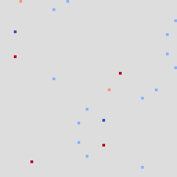
*ρ(wgpu) − ρ(reference), range ±1.19e-7 (lattice units)*

![|u(wgpu) − u(reference)|, range [0, 2.91e-8] (lattice units)](taylor-green-wgpu-u-diff.png)
*|u(wgpu) − u(reference)|, range [0, 2.91e-8] (lattice units)*

### Diagnostics after the last step

| Quantity | cpu | cuda | wgpu |
|----------|---|---|---|
| mass Σρ (lattice) | 4.095999988e3 | 4.095999988e3 | 4.095999987e3 |
| kinetic energy (lattice) | 1.381934865e-2 | 1.381934842e-2 | 1.381957484e-2 |
| max \|u\| (m/s) | 4.690909603e-2 | 4.690909684e-2 | 4.690943360e-2 |

### Reference fields and time series

![Reference speed (m/s), range [3.2589e-3, 4.6909e-2]](taylor-green-reference-speed.png)
*Reference speed (m/s), range [3.2589e-3, 4.6909e-2]*

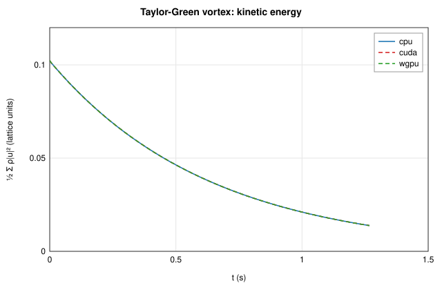

## Plane Poiseuille flow (body force) — ✅ pass

Channel of 32 cells, body force, τ = 1, one diffusive time 6N².

Grid 4×34 (128 fluid cells), 6144 steps (t = 1.000 s, dt = 1.628e-4 s), fields mode, field tolerance 1.00e-5.

### Backends

| Backend | Device | Steps | Time | MLUPS | Result |
|---------|--------|-------|------|-------|--------|
| cpu | cpu | 6144 | 0.15 s | 5 | reference |
| cuda | cuda (NVIDIA GeForce RTX 4060 (CUDA, sm_89, 8.0 GiB, driver 13.4, NVRTC 13.4)) | 6144 | 0.15 s | 5 | ✅ bit-identical |
| wgpu | wgpu (NVIDIA GeForce RTX 4060 (Vulkan, DiscreteGpu)) | 6144 | 0.09 s | 9 | ✅ max diff 5.37e-7 |

### cuda vs cpu

**Lattice fields** (pass/fail on the 04 §7 metric)

| Field | Max abs. diff | Rel. L2 | 04 §7 metric | Limit | Bit-identical |
|-------|---------------|---------|--------------|-------|---------------|
| ρ | 0 | — | 0 | 1.00e-5 | yes |
| ux | 0 | 0 | 0 | 1.00e-5 | yes |
| uy | 0 | 0 | 0 | 1.00e-5 | yes |

**Output fields** (physical units, information)

| Field | Unit | Max abs. diff | Rel. L2 | Bit-identical |
|-------|------|---------------|---------|---------------|
| speed | m/s | 0 | 0 | yes |
| pressure | Pa | 0 | — | yes |
| vorticity | 1/s | 0 | 0 | yes |

**Checks**

| Check | Value | Reference | Error | Limit | Result |
|-------|-------|-----------|-------|-------|--------|
| ρ (04 §7, absolute) | 0 | cpu | 0 | 1.00e-5 | ✅ pass |
| ux (04 §7, relative to the field maximum) | 0 | cpu | 0 | 1.00e-5 | ✅ pass |
| uy (04 §7, relative to the field maximum) | 0 | cpu | 0 | 1.00e-5 | ✅ pass |
| mass Σρ (relative; closed domain) | 128.0 | 128.0 | 0 | 1.00e-7 | ✅ pass |
| kinetic energy (relative) | 9.259e-4 | 9.259e-4 | 1.09e-8 |  | info |
| max \|u\| (relative) | 0.9990 | 0.9990 | 0 |  | info |
| force on Bottom wall (relative to the largest force) | 0.5000 | \|F\| = 0.5000 | 0 |  | info |
| force on Top wall (relative to the largest force) | 0.5000 | \|F\| = 0.5000 | 0 |  | info |

### wgpu vs cpu

**Lattice fields** (pass/fail on the 04 §7 metric)

| Field | Max abs. diff | Rel. L2 | 04 §7 metric | Limit | Bit-identical |
|-------|---------------|---------|--------------|-------|---------------|
| ρ | 0 | — | 0 | 1.00e-5 | yes |
| ux | 2.79e-9 | 3.16e-7 | 5.37e-7 | 1.00e-5 | no |
| uy | 1.46e-10 | 9.14e-1 | 2.80e-8 | 1.00e-5 | no |

**Output fields** (physical units, information)

| Field | Unit | Max abs. diff | Rel. L2 | Bit-identical |
|-------|------|---------------|---------|---------------|
| speed | m/s | 5.36e-7 | 3.29e-7 | no |
| pressure | Pa | 0 | — | yes |
| vorticity | 1/s | 7.15e-6 | 1.13e-6 | no |

**Checks**

| Check | Value | Reference | Error | Limit | Result |
|-------|-------|-----------|-------|-------|--------|
| ρ (04 §7, absolute) | 0 | cpu | 0 | 1.00e-5 | ✅ pass |
| ux (04 §7, relative to the field maximum) | 5.370e-7 | cpu | 5.37e-7 | 1.00e-5 | ✅ pass |
| uy (04 §7, relative to the field maximum) | 2.797e-8 | cpu | 2.80e-8 | 1.00e-5 | ✅ pass |
| mass Σρ (relative; closed domain) | 128.0 | 128.0 | 0 | 1.00e-7 | ✅ pass |
| kinetic energy (relative) | 9.259e-4 | 9.259e-4 | 3.03e-7 |  | info |
| max \|u\| (relative) | 0.9990 | 0.9990 | 4.47e-7 |  | info |
| force on Bottom wall (relative to the largest force) | 0.5000 | \|F\| = 0.5000 | 6.64e-7 |  | info |
| force on Top wall (relative to the largest force) | 0.5000 | \|F\| = 0.5000 | 1.64e-6 |  | info |

![|u(wgpu) − u(reference)|, range [0, 2.80e-9] (lattice units)](poiseuille-wgpu-u-diff.png)
*|u(wgpu) − u(reference)|, range [0, 2.80e-9] (lattice units)*

### Diagnostics after the last step

| Quantity | cpu | cuda | wgpu |
|----------|---|---|---|
| mass Σρ (lattice) | 1.280000000e2 | 1.280000000e2 | 1.280000000e2 |
| kinetic energy (lattice) | 9.258932069e-4 | 9.258931968e-4 | 9.258934879e-4 |
| max \|u\| (m/s) | 9.990037680e-1 | 9.990037680e-1 | 9.990042150e-1 |

### Forces after the last step (N/m)

| Element | Backend | Fx | Fy |
|---------|---------|----|----|
| Bottom wall | cpu | 4.999934e-1 | 6.806367e-7 |
| Bottom wall | cuda | 4.999934e-1 | 6.806367e-7 |
| Bottom wall | wgpu | 4.999937e-1 | 3.485693e-7 |
| Top wall | cpu | 4.999933e-1 | -1.847686e-6 |
| Top wall | cuda | 4.999933e-1 | -1.847686e-6 |
| Top wall | wgpu | 4.999932e-1 | -1.027569e-6 |

### Force statistics from t = 0.5000 s (information)

Coefficients C = 2F/(ρ₀U²L) and St = fL/U with L = 0.1250 m, U = 1.000 m/s.

| Element | Backend | Fx mean | Fx min | Fx max | Fy mean | Fy min | Fy max | C_x mean | C_x max | C_y max | f (Hz) | St |
|---------|---------|---------|--------|--------|---------|--------|--------|----------|---------|---------|--------|----|
| Bottom wall | cpu | 4.99425e-1 | 4.97102e-1 | 4.99993e-1 | 1.19821e-6 | -3.50730e-7 | 2.90878e-6 | 7.991 | 8.000 | 4.654e-5 | — | — |
| Bottom wall | cuda | 4.99425e-1 | 4.97102e-1 | 4.99993e-1 | 1.19821e-6 | -3.50730e-7 | 2.90878e-6 | 7.991 | 8.000 | 4.654e-5 | — | — |
| Bottom wall | wgpu | 4.99425e-1 | 4.97102e-1 | 4.99994e-1 | 1.40922e-6 | 3.48569e-7 | 3.02089e-6 | 7.991 | 8.000 | 4.833e-5 | — | — |
| Top wall | cpu | 4.99425e-1 | 4.97102e-1 | 4.99993e-1 | -1.34385e-6 | -2.92456e-6 | 6.18558e-7 | 7.991 | 8.000 | 9.897e-6 | — | — |
| Top wall | cuda | 4.99425e-1 | 4.97102e-1 | 4.99993e-1 | -1.34385e-6 | -2.92456e-6 | 6.18558e-7 | 7.991 | 8.000 | 9.897e-6 | — | — |
| Top wall | wgpu | 4.99425e-1 | 4.97102e-1 | 4.99993e-1 | -1.50270e-6 | -2.40181e-6 | -1.89902e-7 | 7.991 | 8.000 | -3.038e-6 | — | — |

### Reference fields and time series

![Reference speed (m/s), range [6.1523e-2, 9.9900e-1]](poiseuille-reference-speed.png)
*Reference speed (m/s), range [6.1523e-2, 9.9900e-1]*

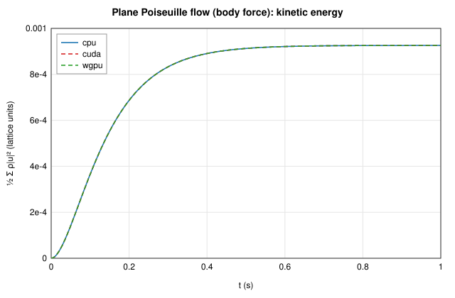

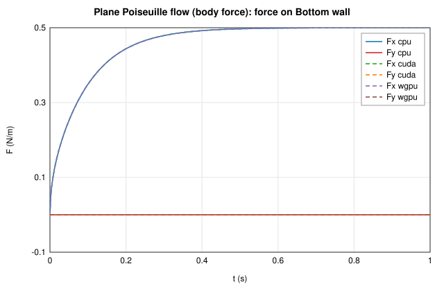

## Plane Couette flow (moving wall) — ✅ pass

Channel of 32 cells, moving top wall, τ = 1, one diffusive time 6N².

Grid 4×34 (128 fluid cells), 6144 steps (t = 1.000 s, dt = 1.628e-4 s), fields mode, field tolerance 1.00e-5.

### Backends

| Backend | Device | Steps | Time | MLUPS | Result |
|---------|--------|-------|------|-------|--------|
| cpu | cpu | 6144 | 0.15 s | 5 | reference |
| cuda | cuda (NVIDIA GeForce RTX 4060 (CUDA, sm_89, 8.0 GiB, driver 13.4, NVRTC 13.4)) | 6144 | 0.13 s | 6 | ✅ bit-identical |
| wgpu | wgpu (NVIDIA GeForce RTX 4060 (Vulkan, DiscreteGpu)) | 6144 | 0.08 s | 10 | ✅ max diff 9.54e-7 |

### cuda vs cpu

**Lattice fields** (pass/fail on the 04 §7 metric)

| Field | Max abs. diff | Rel. L2 | 04 §7 metric | Limit | Bit-identical |
|-------|---------------|---------|--------------|-------|---------------|
| ρ | 0 | — | 0 | 1.00e-5 | yes |
| ux | 0 | 0 | 0 | 1.00e-5 | yes |
| uy | 0 | 0 | 0 | 1.00e-5 | yes |

**Output fields** (physical units, information)

| Field | Unit | Max abs. diff | Rel. L2 | Bit-identical |
|-------|------|---------------|---------|---------------|
| speed | m/s | 0 | 0 | yes |
| pressure | Pa | 0 | — | yes |
| vorticity | 1/s | 0 | 0 | yes |

**Checks**

| Check | Value | Reference | Error | Limit | Result |
|-------|-------|-----------|-------|-------|--------|
| ρ (04 §7, absolute) | 0 | cpu | 0 | 1.00e-5 | ✅ pass |
| ux (04 §7, relative to the field maximum) | 0 | cpu | 0 | 1.00e-5 | ✅ pass |
| uy (04 §7, relative to the field maximum) | 0 | cpu | 0 | 1.00e-5 | ✅ pass |
| mass Σρ (relative; closed domain) | 128.0 | 128.0 | 0 | 1.00e-7 | ✅ pass |
| kinetic energy (relative) | 5.785e-4 | 5.785e-4 | 2.53e-8 |  | info |
| max \|u\| (relative) | 0.9844 | 0.9844 | 0 |  | info |
| force on Bottom wall (relative to the largest force) | 0.1250 | \|F\| = 0.1250 | 0 |  | info |
| force on Top wall (relative to the largest force) | 0.1250 | \|F\| = 0.1250 | 0 |  | info |

### wgpu vs cpu

**Lattice fields** (pass/fail on the 04 §7 metric)

| Field | Max abs. diff | Rel. L2 | 04 §7 metric | Limit | Bit-identical |
|-------|---------------|---------|--------------|-------|---------------|
| ρ | 0 | — | 0 | 1.00e-5 | yes |
| ux | 4.89e-9 | 7.46e-7 | 9.54e-7 | 1.00e-5 | no |
| uy | 1.16e-10 | 1.07e0 | 2.27e-8 | 1.00e-5 | no |

**Output fields** (physical units, information)

| Field | Unit | Max abs. diff | Rel. L2 | Bit-identical |
|-------|------|---------------|---------|---------------|
| speed | m/s | 8.94e-7 | 7.35e-7 | no |
| pressure | Pa | 0 | — | yes |
| vorticity | 1/s | 1.00e-5 | 3.14e-6 | no |

**Checks**

| Check | Value | Reference | Error | Limit | Result |
|-------|-------|-----------|-------|-------|--------|
| ρ (04 §7, absolute) | 0 | cpu | 0 | 1.00e-5 | ✅ pass |
| ux (04 §7, relative to the field maximum) | 9.537e-7 | cpu | 9.54e-7 | 1.00e-5 | ✅ pass |
| uy (04 §7, relative to the field maximum) | 2.271e-8 | cpu | 2.27e-8 | 1.00e-5 | ✅ pass |
| mass Σρ (relative; closed domain) | 128.0 | 128.0 | 0 | 1.00e-7 | ✅ pass |
| kinetic energy (relative) | 5.785e-4 | 5.785e-4 | 1.18e-6 |  | info |
| max \|u\| (relative) | 0.9844 | 0.9844 | 0 |  | info |
| force on Bottom wall (relative to the largest force) | 0.1250 | \|F\| = 0.1250 | 3.94e-6 |  | info |
| force on Top wall (relative to the largest force) | 0.1250 | \|F\| = 0.1250 | 5.70e-7 |  | info |

![|u(wgpu) − u(reference)|, range [0, 4.89e-9] (lattice units)](couette-wgpu-u-diff.png)
*|u(wgpu) − u(reference)|, range [0, 4.89e-9] (lattice units)*

### Diagnostics after the last step

| Quantity | cpu | cuda | wgpu |
|----------|---|---|---|
| mass Σρ (lattice) | 1.280000000e2 | 1.280000000e2 | 1.280000000e2 |
| kinetic energy (lattice) | 5.785336399e-4 | 5.785336252e-4 | 5.785343237e-4 |
| max \|u\| (m/s) | 9.843733907e-1 | 9.843733907e-1 | 9.843733907e-1 |

### Forces after the last step (N/m)

| Element | Backend | Fx | Fy |
|---------|---------|----|----|
| Bottom wall | cpu | 1.249902e-1 | 1.628811e-6 |
| Bottom wall | cuda | 1.249902e-1 | 1.628811e-6 |
| Bottom wall | wgpu | 1.249903e-1 | 1.135981e-6 |
| Top wall | cpu | -1.250134e-1 | -8.842908e-7 |
| Top wall | cuda | -1.250134e-1 | -8.842908e-7 |
| Top wall | wgpu | -1.250134e-1 | -8.130446e-7 |

### Force statistics from t = 0.5000 s (information)

Coefficients C = 2F/(ρ₀U²L) and St = fL/U with L = 0.1250 m, U = 1.000 m/s.

| Element | Backend | Fx mean | Fx min | Fx max | Fy mean | Fy min | Fy max | C_x mean | C_x max | C_y max | f (Hz) | St |
|---------|---------|---------|--------|--------|---------|--------|--------|----------|---------|---------|--------|----|
| Bottom wall | cpu | 1.24641e-1 | 1.23209e-1 | 1.24990e-1 | 9.63910e-7 | -5.51016e-7 | 2.77209e-6 | 1.994 | 2.000 | 4.435e-5 | — | — |
| Bottom wall | cuda | 1.24641e-1 | 1.23209e-1 | 1.24990e-1 | 9.63910e-7 | -5.51016e-7 | 2.77209e-6 | 1.994 | 2.000 | 4.435e-5 | — | — |
| Bottom wall | wgpu | 1.24641e-1 | 1.23209e-1 | 1.24990e-1 | 1.53228e-6 | 9.62855e-8 | 2.64485e-6 | 1.994 | 2.000 | 4.232e-5 | — | — |
| Top wall | cpu | -1.25357e-1 | -1.26787e-1 | -1.25013e-1 | -9.87026e-7 | -4.21610e-6 | 1.21538e-6 | -2.006 | -2.000 | 1.945e-5 | — | — |
| Top wall | cuda | -1.25357e-1 | -1.26787e-1 | -1.25013e-1 | -9.87026e-7 | -4.21610e-6 | 1.21538e-6 | -2.006 | -2.000 | 1.945e-5 | — | — |
| Top wall | wgpu | -1.25357e-1 | -1.26787e-1 | -1.25013e-1 | -1.46770e-6 | -2.93367e-6 | 4.19095e-8 | -2.006 | -2.000 | 6.706e-7 | — | — |

### Reference fields and time series

![Reference speed (m/s), range [1.5624e-2, 9.8437e-1]](couette-reference-speed.png)
*Reference speed (m/s), range [1.5624e-2, 9.8437e-1]*

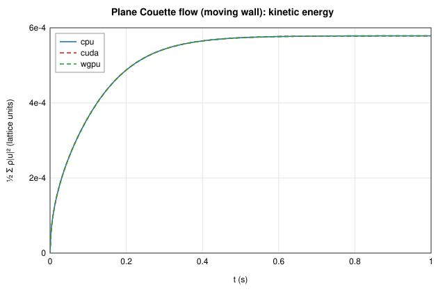

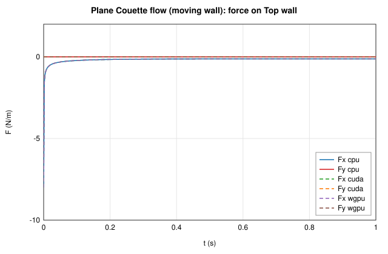

## Lid-driven cavity, Re = 100 — ✅ pass

128² cavity, lid lattice velocity 0.08, 20000 steps (the flow is still developing).

Grid 128×129 (16384 fluid cells), 20000 steps (t = 12.50 s, dt = 6.250e-4 s), fields mode, field tolerance 1.00e-5.

### Backends

| Backend | Device | Steps | Time | MLUPS | Result |
|---------|--------|-------|------|-------|--------|
| cpu | cpu | 20000 | 2.65 s | 123 | reference |
| cuda | cuda (NVIDIA GeForce RTX 4060 (CUDA, sm_89, 8.0 GiB, driver 13.4, NVRTC 13.4)) | 20000 | 0.17 s | 1909 | ✅ bit-identical |
| wgpu | wgpu (NVIDIA GeForce RTX 4060 (Vulkan, DiscreteGpu)) | 20000 | 0.15 s | 2173 | ✅ max diff 7.74e-6 |

### cuda vs cpu

**Lattice fields** (pass/fail on the 04 §7 metric)

| Field | Max abs. diff | Rel. L2 | 04 §7 metric | Limit | Bit-identical |
|-------|---------------|---------|--------------|-------|---------------|
| ρ | 0 | 0 | 0 | 1.00e-5 | yes |
| ux | 0 | 0 | 0 | 1.00e-5 | yes |
| uy | 0 | 0 | 0 | 1.00e-5 | yes |

**Output fields** (physical units, information)

| Field | Unit | Max abs. diff | Rel. L2 | Bit-identical |
|-------|------|---------------|---------|---------------|
| speed | m/s | 0 | 0 | yes |
| pressure | Pa | 0 | 0 | yes |
| vorticity | 1/s | 0 | 0 | yes |

**Checks**

| Check | Value | Reference | Error | Limit | Result |
|-------|-------|-----------|-------|-------|--------|
| ρ (04 §7, absolute) | 0 | cpu | 0 | 1.00e-5 | ✅ pass |
| ux (04 §7, relative to the field maximum) | 0 | cpu | 0 | 1.00e-5 | ✅ pass |
| uy (04 §7, relative to the field maximum) | 0 | cpu | 0 | 1.00e-5 | ✅ pass |
| mass Σρ (relative; closed domain) | 16384 | 16384 | 0 | 1.00e-7 | ✅ pass |
| kinetic energy (relative) | 3.599 | 3.599 | 1.47e-8 |  | info |
| max \|u\| (relative) | 0.9772 | 0.9772 | 5.03e-12 |  | info |
| force on domain edges (relative to the largest force) | 0.2185 | \|F\| = 0.2185 | 0 |  | info |
| force on Lid (relative to the largest force) | 0.2176 | \|F\| = 0.2176 | 0 |  | info |

### wgpu vs cpu

**Lattice fields** (pass/fail on the 04 §7 metric)

| Field | Max abs. diff | Rel. L2 | 04 §7 metric | Limit | Bit-identical |
|-------|---------------|---------|--------------|-------|---------------|
| ρ | 1.19e-7 | 1.92e-5 | 1.19e-7 | 1.00e-5 | no |
| ux | 5.00e-7 | 1.23e-5 | 6.40e-6 | 1.00e-5 | no |
| uy | 6.05e-7 | 1.55e-5 | 7.74e-6 | 1.00e-5 | no |

**Output fields** (physical units, information)

| Field | Unit | Max abs. diff | Rel. L2 | Bit-identical |
|-------|------|---------------|---------|---------------|
| speed | m/s | 7.33e-6 | 1.17e-5 | no |
| pressure | Pa | 6.32e-6 | 1.92e-5 | no |
| vorticity | 1/s | 1.04e-4 | 8.17e-6 | no |

**Checks**

| Check | Value | Reference | Error | Limit | Result |
|-------|-------|-----------|-------|-------|--------|
| ρ (04 §7, absolute) | 1.192e-7 | cpu | 1.19e-7 | 1.00e-5 | ✅ pass |
| ux (04 §7, relative to the field maximum) | 6.397e-6 | cpu | 6.40e-6 | 1.00e-5 | ✅ pass |
| uy (04 §7, relative to the field maximum) | 7.744e-6 | cpu | 7.74e-6 | 1.00e-5 | ✅ pass |
| mass Σρ (relative; closed domain) | 16384 | 16384 | 3.06e-9 | 1.00e-7 | ✅ pass |
| kinetic energy (relative) | 3.599 | 3.599 | 9.27e-6 |  | info |
| max \|u\| (relative) | 0.9772 | 0.9772 | 5.03e-12 |  | info |
| force on domain edges (relative to the largest force) | 0.2185 | \|F\| = 0.2185 | 5.70e-6 |  | info |
| force on Lid (relative to the largest force) | 0.2176 | \|F\| = 0.2176 | 3.51e-6 |  | info |

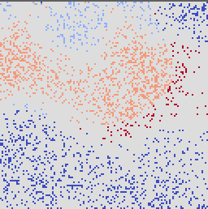
*ρ(wgpu) − ρ(reference), range ±1.19e-7 (lattice units)*

![|u(wgpu) − u(reference)|, range [0, 6.09e-7] (lattice units)](cavity-re100-wgpu-u-diff.png)
*|u(wgpu) − u(reference)|, range [0, 6.09e-7] (lattice units)*

### Diagnostics after the last step

| Quantity | cpu | cuda | wgpu |
|----------|---|---|---|
| mass Σρ (lattice) | 1.638400000e4 | 1.638400000e4 | 1.638399995e4 |
| kinetic energy (lattice) | 3.598778399e0 | 3.598778346e0 | 3.598745032e0 |
| max \|u\| (m/s) | 9.772044607e-1 | 9.772044607e-1 | 9.772044607e-1 |

### Forces after the last step (N/m)

| Element | Backend | Fx | Fy |
|---------|---------|----|----|
| domain edges | cpu | 2.128513e-1 | -4.952332e-2 |
| domain edges | cuda | 2.128513e-1 | -4.952332e-2 |
| domain edges | wgpu | 2.128509e-1 | -4.952211e-2 |
| Lid | cpu | -2.118255e-1 | 4.974255e-2 |
| Lid | cuda | -2.118255e-1 | 4.974255e-2 |
| Lid | wgpu | -2.118256e-1 | 4.974180e-2 |

### Force statistics from t = 6.250 s (information)

Coefficients C = 2F/(ρ₀U²L) and St = fL/U with L = 1.000 m, U = 1.000 m/s.

| Element | Backend | Fx mean | Fx min | Fx max | Fy mean | Fy min | Fy max | C_x mean | C_x max | C_y max | f (Hz) | St |
|---------|---------|---------|--------|--------|---------|--------|--------|----------|---------|---------|--------|----|
| domain edges | cpu | 2.12021e-1 | 1.92468e-1 | 2.33063e-1 | -4.94073e-2 | -4.98917e-2 | -4.79371e-2 | 0.4240 | 0.4661 | -0.09587 | 3.55216 | 3.55216 |
| domain edges | cuda | 2.12021e-1 | 1.92468e-1 | 2.33063e-1 | -4.94073e-2 | -4.98917e-2 | -4.79371e-2 | 0.4240 | 0.4661 | -0.09587 | 3.55216 | 3.55216 |
| domain edges | wgpu | 2.12021e-1 | 1.92469e-1 | 2.33062e-1 | -4.94063e-2 | -4.98924e-2 | -4.79333e-2 | 0.4240 | 0.4661 | -0.09587 | 3.55216 | 3.55216 |
| Lid | cpu | -2.11867e-1 | -2.12484e-1 | -2.11582e-1 | 4.94184e-2 | 4.79552e-2 | 4.99208e-2 | -0.4237 | -0.4232 | 0.09984 | 3.61963 | 3.61963 |
| Lid | cuda | -2.11867e-1 | -2.12484e-1 | -2.11582e-1 | 4.94184e-2 | 4.79552e-2 | 4.99208e-2 | -0.4237 | -0.4232 | 0.09984 | 3.61963 | 3.61963 |
| Lid | wgpu | -2.11867e-1 | -2.12484e-1 | -2.11582e-1 | 4.94178e-2 | 4.79516e-2 | 4.99216e-2 | -0.4237 | -0.4232 | 0.09984 | 3.61928 | 3.61928 |

### Reference fields and time series

![Reference speed (m/s), range [8.4270e-7, 9.7720e-1]](cavity-re100-reference-speed.png)
*Reference speed (m/s), range [8.4270e-7, 9.7720e-1]*

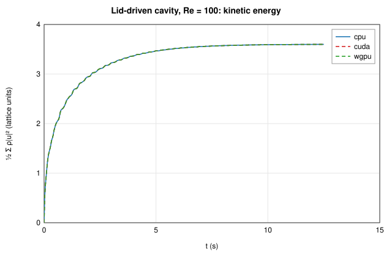

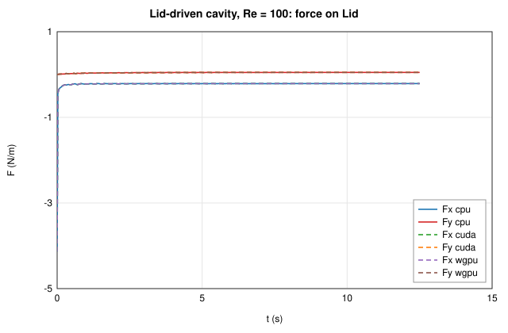

## Lid-driven cavity, Re = 400 — ✅ pass

128² cavity, lid lattice velocity 0.08, 20000 steps (the flow is still developing).

Grid 128×129 (16384 fluid cells), 20000 steps (t = 12.50 s, dt = 6.250e-4 s), fields mode, field tolerance 1.00e-5.

### Backends

| Backend | Device | Steps | Time | MLUPS | Result |
|---------|--------|-------|------|-------|--------|
| cpu | cpu | 20000 | 2.66 s | 123 | reference |
| cuda | cuda (NVIDIA GeForce RTX 4060 (CUDA, sm_89, 8.0 GiB, driver 13.4, NVRTC 13.4)) | 20000 | 0.27 s | 1193 | ✅ bit-identical |
| wgpu | wgpu (NVIDIA GeForce RTX 4060 (Vulkan, DiscreteGpu)) | 20000 | 0.16 s | 2082 | ✅ max diff 5.12e-6 |

### cuda vs cpu

**Lattice fields** (pass/fail on the 04 §7 metric)

| Field | Max abs. diff | Rel. L2 | 04 §7 metric | Limit | Bit-identical |
|-------|---------------|---------|--------------|-------|---------------|
| ρ | 0 | 0 | 0 | 1.00e-5 | yes |
| ux | 0 | 0 | 0 | 1.00e-5 | yes |
| uy | 0 | 0 | 0 | 1.00e-5 | yes |

**Output fields** (physical units, information)

| Field | Unit | Max abs. diff | Rel. L2 | Bit-identical |
|-------|------|---------------|---------|---------------|
| speed | m/s | 0 | 0 | yes |
| pressure | Pa | 0 | 0 | yes |
| vorticity | 1/s | 0 | 0 | yes |

**Checks**

| Check | Value | Reference | Error | Limit | Result |
|-------|-------|-----------|-------|-------|--------|
| ρ (04 §7, absolute) | 0 | cpu | 0 | 1.00e-5 | ✅ pass |
| ux (04 §7, relative to the field maximum) | 0 | cpu | 0 | 1.00e-5 | ✅ pass |
| uy (04 §7, relative to the field maximum) | 0 | cpu | 0 | 1.00e-5 | ✅ pass |
| mass Σρ (relative; closed domain) | 16384 | 16384 | 0 | 1.00e-7 | ✅ pass |
| kinetic energy (relative) | 3.923 | 3.923 | 1.09e-8 |  | info |
| max \|u\| (relative) | 0.9637 | 0.9637 | 6.78e-12 |  | info |
| force on domain edges (relative to the largest force) | 0.07373 | \|F\| = 0.07373 | 0 |  | info |
| force on Lid (relative to the largest force) | 0.08332 | \|F\| = 0.08332 | 0 |  | info |

### wgpu vs cpu

**Lattice fields** (pass/fail on the 04 §7 metric)

| Field | Max abs. diff | Rel. L2 | 04 §7 metric | Limit | Bit-identical |
|-------|---------------|---------|--------------|-------|---------------|
| ρ | 1.19e-7 | 7.29e-5 | 1.19e-7 | 1.00e-5 | no |
| ux | 3.30e-7 | 7.23e-6 | 4.28e-6 | 1.00e-5 | no |
| uy | 3.95e-7 | 8.38e-6 | 5.12e-6 | 1.00e-5 | no |

**Output fields** (physical units, information)

| Field | Unit | Max abs. diff | Rel. L2 | Bit-identical |
|-------|------|---------------|---------|---------------|
| speed | m/s | 4.93e-6 | 7.20e-6 | no |
| pressure | Pa | 6.26e-6 | 7.29e-5 | no |
| vorticity | 1/s | 1.18e-4 | 6.74e-6 | no |

**Checks**

| Check | Value | Reference | Error | Limit | Result |
|-------|-------|-----------|-------|-------|--------|
| ρ (04 §7, absolute) | 1.192e-7 | cpu | 1.19e-7 | 1.00e-5 | ✅ pass |
| ux (04 §7, relative to the field maximum) | 4.276e-6 | cpu | 4.28e-6 | 1.00e-5 | ✅ pass |
| uy (04 §7, relative to the field maximum) | 5.122e-6 | cpu | 5.12e-6 | 1.00e-5 | ✅ pass |
| mass Σρ (relative; closed domain) | 16384 | 16384 | 7.42e-10 | 1.00e-7 | ✅ pass |
| kinetic energy (relative) | 3.923 | 3.923 | 1.82e-6 |  | info |
| max \|u\| (relative) | 0.9637 | 0.9637 | 1.93e-7 |  | info |
| force on domain edges (relative to the largest force) | 0.07373 | \|F\| = 0.07373 | 5.10e-5 |  | info |
| force on Lid (relative to the largest force) | 0.08332 | \|F\| = 0.08332 | 5.93e-5 |  | info |

*ρ(wgpu) − ρ(reference), range ±1.19e-7 (lattice units)*

![|u(wgpu) − u(reference)|, range [0, 3.97e-7] (lattice units)](cavity-re400-wgpu-u-diff.png)
*|u(wgpu) − u(reference)|, range [0, 3.97e-7] (lattice units)*

### Diagnostics after the last step

| Quantity | cpu | cuda | wgpu |
|----------|---|---|---|
| mass Σρ (lattice) | 1.638400000e4 | 1.638400000e4 | 1.638399999e4 |
| kinetic energy (lattice) | 3.922688031e0 | 3.922688073e0 | 3.922680879e0 |
| max \|u\| (m/s) | 9.636917152e-1 | 9.636917152e-1 | 9.636919014e-1 |

### Forces after the last step (N/m)

| Element | Backend | Fx | Fy |
|---------|---------|----|----|
| domain edges | cpu | 5.461003e-2 | -4.954296e-2 |
| domain edges | cuda | 5.461003e-2 | -4.954296e-2 |
| domain edges | wgpu | 5.461131e-2 | -4.953953e-2 |
| Lid | cpu | -6.731578e-2 | 4.909855e-2 |
| Lid | cuda | -6.731578e-2 | 4.909855e-2 |
| Lid | wgpu | -6.731592e-2 | 4.910254e-2 |

### Force statistics from t = 6.250 s (information)

Coefficients C = 2F/(ρ₀U²L) and St = fL/U with L = 1.000 m, U = 1.000 m/s.

| Element | Backend | Fx mean | Fx min | Fx max | Fy mean | Fy min | Fy max | C_x mean | C_x max | C_y max | f (Hz) | St |
|---------|---------|---------|--------|--------|---------|--------|--------|----------|---------|---------|--------|----|
| domain edges | cpu | 6.78248e-2 | 1.56781e-2 | 1.24175e-1 | -4.51704e-2 | -4.96060e-2 | -3.89147e-2 | 0.1356 | 0.2483 | -0.07783 | 3.58197 | 3.58197 |
| domain edges | cuda | 6.78248e-2 | 1.56781e-2 | 1.24175e-1 | -4.51704e-2 | -4.96060e-2 | -3.89147e-2 | 0.1356 | 0.2483 | -0.07783 | 3.58197 | 3.58197 |
| domain edges | wgpu | 6.78250e-2 | 1.56786e-2 | 1.24175e-1 | -4.51702e-2 | -4.96099e-2 | -3.89138e-2 | 0.1357 | 0.2484 | -0.07783 | 3.58197 | 3.58197 |
| Lid | cpu | -6.77121e-2 | -6.88736e-2 | -6.71908e-2 | 4.51528e-2 | 3.89231e-2 | 4.97379e-2 | -0.1354 | -0.1344 | 0.09948 | 4.28028 | 4.28028 |
| Lid | cuda | -6.77121e-2 | -6.88736e-2 | -6.71908e-2 | 4.51528e-2 | 3.89231e-2 | 4.97379e-2 | -0.1354 | -0.1344 | 0.09948 | 4.28028 | 4.28028 |
| Lid | wgpu | -6.77122e-2 | -6.88736e-2 | -6.71910e-2 | 4.51528e-2 | 3.89242e-2 | 4.97394e-2 | -0.1354 | -0.1344 | 0.09948 | 4.27214 | 4.27214 |

### Reference fields and time series

![Reference speed (m/s), range [5.0270e-6, 9.6369e-1]](cavity-re400-reference-speed.png)
*Reference speed (m/s), range [5.0270e-6, 9.6369e-1]*

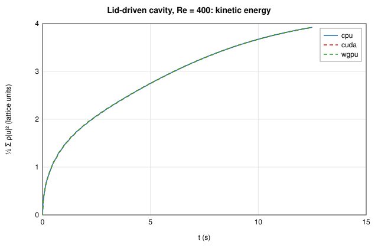

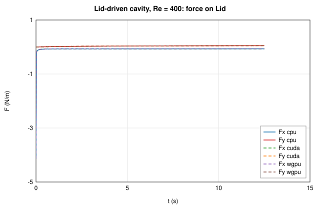

## Lid-driven cavity, Re = 1000 — ✅ pass

128² cavity, lid lattice velocity 0.08, 20000 steps (the flow is still developing).

Grid 128×129 (16384 fluid cells), 20000 steps (t = 12.50 s, dt = 6.250e-4 s), fields mode, field tolerance 1.00e-5.

### Backends

| Backend | Device | Steps | Time | MLUPS | Result |
|---------|--------|-------|------|-------|--------|
| cpu | cpu | 20000 | 2.67 s | 123 | reference |
| cuda | cuda (NVIDIA GeForce RTX 4060 (CUDA, sm_89, 8.0 GiB, driver 13.4, NVRTC 13.4)) | 20000 | 0.35 s | 925 | ✅ bit-identical |
| wgpu | wgpu (NVIDIA GeForce RTX 4060 (Vulkan, DiscreteGpu)) | 20000 | 0.16 s | 1998 | ✅ max diff 3.94e-6 |

### cuda vs cpu

**Lattice fields** (pass/fail on the 04 §7 metric)

| Field | Max abs. diff | Rel. L2 | 04 §7 metric | Limit | Bit-identical |
|-------|---------------|---------|--------------|-------|---------------|
| ρ | 0 | 0 | 0 | 1.00e-5 | yes |
| ux | 0 | 0 | 0 | 1.00e-5 | yes |
| uy | 0 | 0 | 0 | 1.00e-5 | yes |

**Output fields** (physical units, information)

| Field | Unit | Max abs. diff | Rel. L2 | Bit-identical |
|-------|------|---------------|---------|---------------|
| speed | m/s | 0 | 0 | yes |
| pressure | Pa | 0 | 0 | yes |
| vorticity | 1/s | 0 | 0 | yes |

**Checks**

| Check | Value | Reference | Error | Limit | Result |
|-------|-------|-----------|-------|-------|--------|
| ρ (04 §7, absolute) | 0 | cpu | 0 | 1.00e-5 | ✅ pass |
| ux (04 §7, relative to the field maximum) | 0 | cpu | 0 | 1.00e-5 | ✅ pass |
| uy (04 §7, relative to the field maximum) | 0 | cpu | 0 | 1.00e-5 | ✅ pass |
| mass Σρ (relative; closed domain) | 16384 | 16384 | 0 | 1.00e-7 | ✅ pass |
| kinetic energy (relative) | 3.439 | 3.439 | 1.59e-10 |  | info |
| max \|u\| (relative) | 0.9407 | 0.9407 | 9.42e-12 |  | info |
| force on domain edges (relative to the largest force) | 0.04209 | \|F\| = 0.04209 | 0 |  | info |
| force on Lid (relative to the largest force) | 0.05373 | \|F\| = 0.05373 | 0 |  | info |

### wgpu vs cpu

**Lattice fields** (pass/fail on the 04 §7 metric)

| Field | Max abs. diff | Rel. L2 | 04 §7 metric | Limit | Bit-identical |
|-------|---------------|---------|--------------|-------|---------------|
| ρ | 1.19e-7 | 4.34e-5 | 1.19e-7 | 1.00e-5 | no |
| ux | 2.96e-7 | 6.12e-6 | 3.94e-6 | 1.00e-5 | no |
| uy | 2.53e-7 | 6.69e-6 | 3.37e-6 | 1.00e-5 | no |

**Output fields** (physical units, information)

| Field | Unit | Max abs. diff | Rel. L2 | Bit-identical |
|-------|------|---------------|---------|---------------|
| speed | m/s | 3.84e-6 | 6.08e-6 | no |
| pressure | Pa | 6.23e-6 | 4.34e-5 | no |
| vorticity | 1/s | 1.00e-4 | 5.58e-6 | no |

**Checks**

| Check | Value | Reference | Error | Limit | Result |
|-------|-------|-----------|-------|-------|--------|
| ρ (04 §7, absolute) | 1.192e-7 | cpu | 1.19e-7 | 1.00e-5 | ✅ pass |
| ux (04 §7, relative to the field maximum) | 3.935e-6 | cpu | 3.94e-6 | 1.00e-5 | ✅ pass |
| uy (04 §7, relative to the field maximum) | 3.366e-6 | cpu | 3.37e-6 | 1.00e-5 | ✅ pass |
| mass Σρ (relative; closed domain) | 16384 | 16384 | 5.17e-10 | 1.00e-7 | ✅ pass |
| kinetic energy (relative) | 3.439 | 3.439 | 2.31e-6 |  | info |
| max \|u\| (relative) | 0.9407 | 0.9407 | 1.98e-7 |  | info |
| force on domain edges (relative to the largest force) | 0.04209 | \|F\| = 0.04209 | 2.77e-5 |  | info |
| force on Lid (relative to the largest force) | 0.05373 | \|F\| = 0.05373 | 7.70e-6 |  | info |

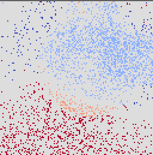
*ρ(wgpu) − ρ(reference), range ±1.19e-7 (lattice units)*

![|u(wgpu) − u(reference)|, range [0, 3.07e-7] (lattice units)](cavity-re1000-wgpu-u-diff.png)
*|u(wgpu) − u(reference)|, range [0, 3.07e-7] (lattice units)*

### Diagnostics after the last step

| Quantity | cpu | cuda | wgpu |
|----------|---|---|---|
| mass Σρ (lattice) | 1.638400000e4 | 1.638400000e4 | 1.638399999e4 |
| kinetic energy (lattice) | 3.439479735e0 | 3.439479734e0 | 3.439487663e0 |
| max \|u\| (m/s) | 9.407214820e-1 | 9.407214820e-1 | 9.407216683e-1 |

### Forces after the last step (N/m)

| Element | Backend | Fx | Fy |
|---------|---------|----|----|
| domain edges | cpu | 9.418336e-3 | -4.102165e-2 |
| domain edges | cuda | 9.418336e-3 | -4.102165e-2 |
| domain edges | wgpu | 9.417697e-3 | -4.102279e-2 |
| Lid | cpu | -3.563389e-2 | 4.021155e-2 |
| Lid | cuda | -3.563389e-2 | 4.021155e-2 |
| Lid | wgpu | -3.563417e-2 | 4.021124e-2 |

### Force statistics from t = 6.250 s (information)

Coefficients C = 2F/(ρ₀U²L) and St = fL/U with L = 1.000 m, U = 1.000 m/s.

| Element | Backend | Fx mean | Fx min | Fx max | Fy mean | Fy min | Fy max | C_x mean | C_x max | C_y max | f (Hz) | St |
|---------|---------|---------|--------|--------|---------|--------|--------|----------|---------|---------|--------|----|
| domain edges | cpu | 3.57719e-2 | -2.27201e-2 | 9.18586e-2 | -3.47184e-2 | -4.10216e-2 | -2.81381e-2 | 0.07154 | 0.1837 | -0.05628 | 3.59184 | 3.59184 |
| domain edges | cuda | 3.57719e-2 | -2.27201e-2 | 9.18586e-2 | -3.47184e-2 | -4.10216e-2 | -2.81381e-2 | 0.07154 | 0.1837 | -0.05628 | 3.59184 | 3.59184 |
| domain edges | wgpu | 3.57720e-2 | -2.27205e-2 | 9.18586e-2 | -3.47183e-2 | -4.10228e-2 | -2.81399e-2 | 0.07154 | 0.1837 | -0.05628 | 3.59184 | 3.59184 |
| Lid | cpu | -3.59388e-2 | -3.65393e-2 | -3.55805e-2 | 3.46860e-2 | 2.77167e-2 | 4.08864e-2 | -0.07188 | -0.07116 | 0.08177 | — | — |
| Lid | cuda | -3.59388e-2 | -3.65393e-2 | -3.55805e-2 | 3.46860e-2 | 2.77167e-2 | 4.08864e-2 | -0.07188 | -0.07116 | 0.08177 | — | — |
| Lid | wgpu | -3.59389e-2 | -3.65392e-2 | -3.55808e-2 | 3.46860e-2 | 2.77173e-2 | 4.08891e-2 | -0.07188 | -0.07116 | 0.08178 | — | — |

### Reference fields and time series

![Reference speed (m/s), range [5.8722e-6, 9.4072e-1]](cavity-re1000-reference-speed.png)
*Reference speed (m/s), range [5.8722e-6, 9.4072e-1]*

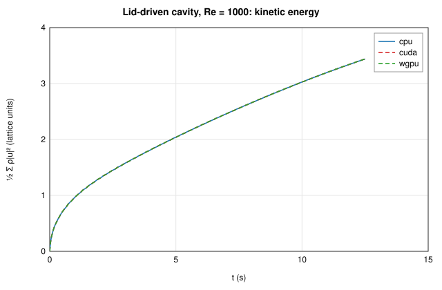

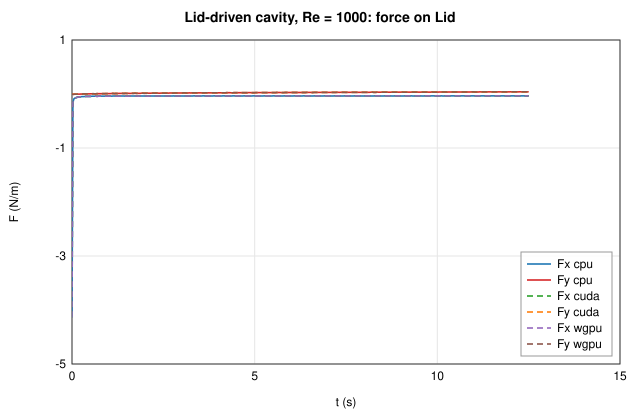

## Cylinder in a channel, Re = 20 — ✅ pass

Schäfer-Turek 2D-1 geometry, D = 20 cells, 20000 steps (approaching the steady state). Coefficients with L = D and U = Ū.

Grid 442×84 (35764 fluid cells), 20000 steps (t = 26.67 s, dt = 0.001333 s), fields mode, field tolerance 1.00e-5.

### Backends

| Backend | Device | Steps | Time | MLUPS | Result |
|---------|--------|-------|------|-------|--------|
| cpu | cpu | 20000 | 4.66 s | 153 | reference |
| cuda | cuda (NVIDIA GeForce RTX 4060 (CUDA, sm_89, 8.0 GiB, driver 13.4, NVRTC 13.4)) | 20000 | 0.41 s | 1752 | ✅ bit-identical |
| wgpu | wgpu (NVIDIA GeForce RTX 4060 (Vulkan, DiscreteGpu)) | 20000 | 0.22 s | 3211 | ✅ max diff 3.15e-6 |

### cuda vs cpu

**Lattice fields** (pass/fail on the 04 §7 metric)

| Field | Max abs. diff | Rel. L2 | 04 §7 metric | Limit | Bit-identical |
|-------|---------------|---------|--------------|-------|---------------|
| ρ | 0 | 0 | 0 | 1.00e-5 | yes |
| ux | 0 | 0 | 0 | 1.00e-5 | yes |
| uy | 0 | 0 | 0 | 1.00e-5 | yes |

**Output fields** (physical units, information)

| Field | Unit | Max abs. diff | Rel. L2 | Bit-identical |
|-------|------|---------------|---------|---------------|
| speed | m/s | 0 | 0 | yes |
| pressure | Pa | 0 | 0 | yes |
| vorticity | 1/s | 0 | 0 | yes |

**Checks**

| Check | Value | Reference | Error | Limit | Result |
|-------|-------|-----------|-------|-------|--------|
| ρ (04 §7, absolute) | 0 | cpu | 0 | 1.00e-5 | ✅ pass |
| ux (04 §7, relative to the field maximum) | 0 | cpu | 0 | 1.00e-5 | ✅ pass |
| uy (04 §7, relative to the field maximum) | 0 | cpu | 0 | 1.00e-5 | ✅ pass |
| mass Σρ (relative; open boundaries) | 35941 | 35941 | 2.16e-11 |  | info |
| kinetic energy (relative) | 61.90 | 61.90 | 2.51e-10 |  | info |
| max \|u\| (relative) | 0.4018 | 0.4018 | 3.51e-9 |  | info |
| force on Channel walls (relative to the largest force) | 0.01756 | \|F\| = 0.01756 | 0 |  | info |
| force on Inlet (relative to the largest force) | 0.05029 | \|F\| = 0.05029 | 0 |  | info |
| force on Cylinder (relative to the largest force) | 0.01122 | \|F\| = 0.01122 | 0 |  | info |

### wgpu vs cpu

**Lattice fields** (pass/fail on the 04 §7 metric)

| Field | Max abs. diff | Rel. L2 | 04 §7 metric | Limit | Bit-identical |
|-------|---------------|---------|--------------|-------|---------------|
| ρ | 4.77e-7 | 4.40e-5 | 4.77e-7 | 1.00e-5 | no |
| ux | 3.32e-7 | 2.08e-6 | 3.15e-6 | 1.00e-5 | no |
| uy | 1.15e-7 | 4.92e-6 | 1.10e-6 | 1.00e-5 | no |

**Output fields** (physical units, information)

| Field | Unit | Max abs. diff | Rel. L2 | Bit-identical |
|-------|------|---------------|---------|---------------|
| speed | m/s | 1.24e-6 | 2.07e-6 | no |
| pressure | Pa | 2.24e-6 | 4.40e-5 | no |
| vorticity | 1/s | 7.27e-5 | 5.49e-6 | no |

**Checks**

| Check | Value | Reference | Error | Limit | Result |
|-------|-------|-----------|-------|-------|--------|
| ρ (04 §7, absolute) | 4.768e-7 | cpu | 4.77e-7 | 1.00e-5 | ✅ pass |
| ux (04 §7, relative to the field maximum) | 3.154e-6 | cpu | 3.15e-6 | 1.00e-5 | ✅ pass |
| uy (04 §7, relative to the field maximum) | 1.096e-6 | cpu | 1.10e-6 | 1.00e-5 | ✅ pass |
| mass Σρ (relative; open boundaries) | 35941 | 35941 | 2.29e-7 |  | info |
| kinetic energy (relative) | 61.90 | 61.90 | 1.67e-7 |  | info |
| max \|u\| (relative) | 0.4018 | 0.4018 | 5.60e-7 |  | info |
| force on Channel walls (relative to the largest force) | 0.01756 | \|F\| = 0.01756 | 2.51e-6 |  | info |
| force on Inlet (relative to the largest force) | 0.05029 | \|F\| = 0.05029 | 1.60e-5 |  | info |
| force on Cylinder (relative to the largest force) | 0.01122 | \|F\| = 0.01122 | 2.17e-7 |  | info |

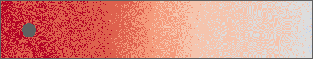
*ρ(wgpu) − ρ(reference), range ±4.77e-7 (lattice units)*

![|u(wgpu) − u(reference)|, range [0, 3.34e-7] (lattice units)](cylinder-re20-wgpu-u-diff.png)
*|u(wgpu) − u(reference)|, range [0, 3.34e-7] (lattice units)*

### Diagnostics after the last step

| Quantity | cpu | cuda | wgpu |
|----------|---|---|---|
| mass Σρ (lattice) | 3.594104969e4 | 3.594104969e4 | 3.594105793e4 |
| kinetic energy (lattice) | 6.190110401e1 | 6.190110399e1 | 6.190109365e1 |
| max \|u\| (m/s) | 4.017626666e-1 | 4.017626680e-1 | 4.017628916e-1 |

### Forces after the last step (N/m)

| Element | Backend | Fx | Fy |
|---------|---------|----|----|
| Channel walls | cpu | 1.756188e-2 | -1.576843e-5 |
| Channel walls | cuda | 1.756188e-2 | -1.576843e-5 |
| Channel walls | wgpu | 1.756201e-2 | -1.576524e-5 |
| Inlet | cpu | -5.028678e-2 | 4.084924e-6 |
| Inlet | cuda | -5.028678e-2 | 4.084924e-6 |
| Inlet | wgpu | -5.028758e-2 | 4.084138e-6 |
| Cylinder | cpu | 1.122029e-2 | 2.498122e-5 |
| Cylinder | cuda | 1.122029e-2 | 2.498122e-5 |
| Cylinder | wgpu | 1.122030e-2 | 2.498324e-5 |

### Force statistics from t = 13.33 s (information)

Coefficients C = 2F/(ρ₀U²L) and St = fL/U with L = 0.1000 m, U = 0.2000 m/s.

| Element | Backend | Fx mean | Fx min | Fx max | Fy mean | Fy min | Fy max | C_x mean | C_x max | C_y max | f (Hz) | St |
|---------|---------|---------|--------|--------|---------|--------|--------|----------|---------|---------|--------|----|
| Channel walls | cpu | 1.75176e-2 | 1.56497e-2 | 1.99552e-2 | -1.65501e-5 | -1.29213e-4 | 8.75082e-5 | 8.759 | 9.978 | 0.04375 | 0.22964 | 0.11482 |
| Channel walls | cuda | 1.75176e-2 | 1.56497e-2 | 1.99552e-2 | -1.65501e-5 | -1.29213e-4 | 8.75082e-5 | 8.759 | 9.978 | 0.04375 | 0.22964 | 0.11482 |
| Channel walls | wgpu | 1.75177e-2 | 1.56499e-2 | 1.99552e-2 | -1.65509e-5 | -1.29218e-4 | 8.74990e-5 | 8.759 | 9.978 | 0.04375 | 0.22964 | 0.11482 |
| Inlet | cpu | -4.91811e-2 | -6.78409e-2 | -3.47202e-2 | 4.10299e-6 | 3.90471e-6 | 4.42691e-6 | -24.59 | -17.36 | 0.002213 | 0.23850 | 0.11925 |
| Inlet | cuda | -4.91811e-2 | -6.78409e-2 | -3.47202e-2 | 4.10299e-6 | 3.90471e-6 | 4.42691e-6 | -24.59 | -17.36 | 0.002213 | 0.23850 | 0.11925 |
| Inlet | wgpu | -4.91817e-2 | -6.78409e-2 | -3.47213e-2 | 4.10300e-6 | 3.90471e-6 | 4.42625e-6 | -24.59 | -17.36 | 0.002213 | 0.23850 | 0.11925 |
| Cylinder | cpu | 1.12267e-2 | 1.09126e-2 | 1.17016e-2 | 2.52023e-5 | 2.12920e-5 | 3.18727e-5 | 5.613 | 5.851 | 0.01594 | 0.23838 | 0.11919 |
| Cylinder | cuda | 1.12267e-2 | 1.09126e-2 | 1.17016e-2 | 2.52023e-5 | 2.12920e-5 | 3.18727e-5 | 5.613 | 5.851 | 0.01594 | 0.23838 | 0.11919 |
| Cylinder | wgpu | 1.12267e-2 | 1.09126e-2 | 1.17018e-2 | 2.52026e-5 | 2.12962e-5 | 3.18737e-5 | 5.613 | 5.851 | 0.01594 | 0.23838 | 0.11919 |

### Reference fields and time series

![Reference speed (m/s), range [8.1647e-4, 4.0176e-1]](cylinder-re20-reference-speed.png)
*Reference speed (m/s), range [8.1647e-4, 4.0176e-1]*

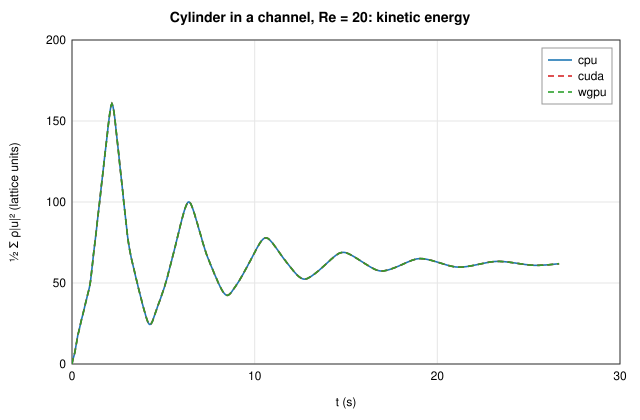

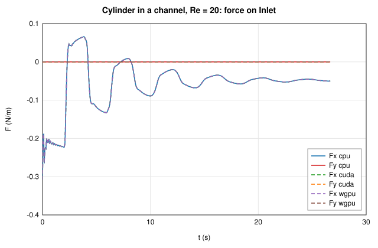

## Cylinder in a channel, Re = 100 (statistics) — ✅ pass

Schäfer-Turek 2D-2 geometry, D = 20 cells, 20 s of simulated time (≈ 60 shedding periods). The vortex street is periodic from t ≈ 7 s; by then round-off differences have grown enough for the instantaneous fields of backends that are not bit-identical to differ, so the verdict uses the force statistics from t = 10 s (≈ 30 periods, ≈ 1000 samples per second): St = fD/Ū and the mean, minimum and maximum of the drag and lift.

Grid 442×84 (35764 fluid cells), 75000 steps (t = 20.00 s, dt = 2.667e-4 s), statistics mode, field tolerance 1.00e-5, statistics from t = 10.00 s with tolerance 1.00e-3.

### Backends

| Backend | Device | Steps | Time | MLUPS | Result |
|---------|--------|-------|------|-------|--------|
| cpu | cpu | 75000 | 18.74 s | 143 | reference |
| cuda | cuda (NVIDIA GeForce RTX 4060 (CUDA, sm_89, 8.0 GiB, driver 13.4, NVRTC 13.4)) | 75000 | 1.89 s | 1417 | ✅ bit-identical |
| wgpu | wgpu (NVIDIA GeForce RTX 4060 (Vulkan, DiscreteGpu)) | 75000 | 3.96 s | 678 | ✅ statistics within 5.18e-6 (fields differ) |

### cuda vs cpu

**Lattice fields** (pass/fail on the 04 §7 metric in fields mode; information only here)

| Field | Max abs. diff | Rel. L2 | 04 §7 metric | Limit | Bit-identical |
|-------|---------------|---------|--------------|-------|---------------|
| ρ | 0 | 0 | 0 | — | yes |
| ux | 0 | 0 | 0 | — | yes |
| uy | 0 | 0 | 0 | — | yes |

**Output fields** (physical units, information)

| Field | Unit | Max abs. diff | Rel. L2 | Bit-identical |
|-------|------|---------------|---------|---------------|
| speed | m/s | 0 | 0 | yes |
| pressure | Pa | 0 | 0 | yes |
| vorticity | 1/s | 0 | 0 | yes |

**Checks**

| Check | Value | Reference | Error | Limit | Result |
|-------|-------|-----------|-------|-------|--------|
| mean kinetic energy over the window (relative) | 69.04 | 69.04 | 1.65e-11 | 1.00e-3 | ✅ pass |
| Channel walls: frequency (Hz, relative) | 2.962 | 2.962 | 0 | 1.00e-3 | ✅ pass |
| Channel walls: mean Fx (N/m, relative to the largest force) | 0.09038 | 0.09038 | 0 | 1.00e-3 | ✅ pass |
| Channel walls: min Fx (N/m, relative to the largest force) | 0.08927 | 0.08927 | 0 | 1.00e-3 | ✅ pass |
| Channel walls: max Fx (N/m, relative to the largest force) | 0.09148 | 0.09148 | 0 | 1.00e-3 | ✅ pass |
| Channel walls: mean Fy (N/m, relative to the largest force) | 0.002260 | 0.002260 | 0 | 1.00e-3 | ✅ pass |
| Channel walls: min Fy (N/m, relative to the largest force) | -0.07568 | -0.07568 | 0 | 1.00e-3 | ✅ pass |
| Channel walls: max Fy (N/m, relative to the largest force) | 0.07801 | 0.07801 | 0 | 1.00e-3 | ✅ pass |
| Inlet: frequency (Hz, relative) | 5.931 | 5.931 | 0 | 1.00e-3 | ✅ pass |
| Inlet: mean Fx (N/m, relative to the largest force) | -0.7589 | -0.7589 | 0 | 1.00e-3 | ✅ pass |
| Inlet: min Fx (N/m, relative to the largest force) | -0.7991 | -0.7991 | 0 | 1.00e-3 | ✅ pass |
| Inlet: max Fx (N/m, relative to the largest force) | -0.7220 | -0.7220 | 0 | 1.00e-3 | ✅ pass |
| Inlet: mean Fy (N/m, relative to the largest force) | -9.364e-5 | -9.364e-5 | 0 | 1.00e-3 | ✅ pass |
| Inlet: min Fy (N/m, relative to the largest force) | -6.670e-4 | -6.670e-4 | 0 | 1.00e-3 | ✅ pass |
| Inlet: max Fy (N/m, relative to the largest force) | 4.719e-4 | 4.719e-4 | 0 | 1.00e-3 | ✅ pass |
| Cylinder: frequency (Hz, relative) | 2.962 | 2.962 | 0 | 1.00e-3 | ✅ pass |
| Cylinder: mean Fx (N/m, relative to the largest force) | 0.1652 | 0.1652 | 0 | 1.00e-3 | ✅ pass |
| Cylinder: min Fx (N/m, relative to the largest force) | 0.1622 | 0.1622 | 0 | 1.00e-3 | ✅ pass |
| Cylinder: max Fx (N/m, relative to the largest force) | 0.1683 | 0.1683 | 0 | 1.00e-3 | ✅ pass |
| Cylinder: mean Fy (N/m, relative to the largest force) | -0.001299 | -0.001299 | 0 | 1.00e-3 | ✅ pass |
| Cylinder: min Fy (N/m, relative to the largest force) | -0.05260 | -0.05260 | 0 | 1.00e-3 | ✅ pass |
| Cylinder: max Fy (N/m, relative to the largest force) | 0.05069 | 0.05069 | 0 | 1.00e-3 | ✅ pass |

### wgpu vs cpu

**Lattice fields** (pass/fail on the 04 §7 metric in fields mode; information only here)

| Field | Max abs. diff | Rel. L2 | 04 §7 metric | Limit | Bit-identical |
|-------|---------------|---------|--------------|-------|---------------|
| ρ | 1.19e-6 | 9.86e-5 | 1.19e-6 | — | no |
| ux | 1.24e-5 | 3.07e-5 | 1.09e-4 | — | no |
| uy | 1.81e-5 | 1.89e-4 | 1.59e-4 | — | no |

**Output fields** (physical units, information)

| Field | Unit | Max abs. diff | Rel. L2 | Bit-identical |
|-------|------|---------------|---------|---------------|
| speed | m/s | 2.17e-4 | 3.25e-5 | no |
| pressure | Pa | 1.40e-4 | 9.86e-5 | no |
| vorticity | 1/s | 1.81e-2 | 1.37e-4 | no |

**Checks**

| Check | Value | Reference | Error | Limit | Result |
|-------|-------|-----------|-------|-------|--------|
| mean kinetic energy over the window (relative) | 69.04 | 69.04 | 1.32e-6 | 1.00e-3 | ✅ pass |
| Channel walls: frequency (Hz, relative) | 2.962 | 2.962 | 7.72e-7 | 1.00e-3 | ✅ pass |
| Channel walls: mean Fx (N/m, relative to the largest force) | 0.09038 | 0.09038 | 5.36e-7 | 1.00e-3 | ✅ pass |
| Channel walls: min Fx (N/m, relative to the largest force) | 0.08927 | 0.08927 | 5.70e-7 | 1.00e-3 | ✅ pass |
| Channel walls: max Fx (N/m, relative to the largest force) | 0.09148 | 0.09148 | 5.28e-7 | 1.00e-3 | ✅ pass |
| Channel walls: mean Fy (N/m, relative to the largest force) | 0.002260 | 0.002260 | 1.48e-8 | 1.00e-3 | ✅ pass |
| Channel walls: min Fy (N/m, relative to the largest force) | -0.07568 | -0.07568 | 1.68e-8 | 1.00e-3 | ✅ pass |
| Channel walls: max Fy (N/m, relative to the largest force) | 0.07801 | 0.07801 | 1.55e-6 | 1.00e-3 | ✅ pass |
| Inlet: frequency (Hz, relative) | 5.931 | 5.931 | 7.94e-7 | 1.00e-3 | ✅ pass |
| Inlet: mean Fx (N/m, relative to the largest force) | -0.7589 | -0.7589 | 4.62e-6 | 1.00e-3 | ✅ pass |
| Inlet: min Fx (N/m, relative to the largest force) | -0.7991 | -0.7991 | 3.66e-6 | 1.00e-3 | ✅ pass |
| Inlet: max Fx (N/m, relative to the largest force) | -0.7220 | -0.7220 | 5.18e-6 | 1.00e-3 | ✅ pass |
| Inlet: mean Fy (N/m, relative to the largest force) | -9.363e-5 | -9.364e-5 | 1.38e-9 | 1.00e-3 | ✅ pass |
| Inlet: min Fy (N/m, relative to the largest force) | -6.670e-4 | -6.670e-4 | 3.35e-8 | 1.00e-3 | ✅ pass |
| Inlet: max Fy (N/m, relative to the largest force) | 4.719e-4 | 4.719e-4 | 4.64e-10 | 1.00e-3 | ✅ pass |
| Cylinder: frequency (Hz, relative) | 2.962 | 2.962 | 8.92e-7 | 1.00e-3 | ✅ pass |
| Cylinder: mean Fx (N/m, relative to the largest force) | 0.1652 | 0.1652 | 4.20e-8 | 1.00e-3 | ✅ pass |
| Cylinder: min Fx (N/m, relative to the largest force) | 0.1622 | 0.1622 | 2.19e-7 | 1.00e-3 | ✅ pass |
| Cylinder: max Fx (N/m, relative to the largest force) | 0.1683 | 0.1683 | 1.05e-7 | 1.00e-3 | ✅ pass |
| Cylinder: mean Fy (N/m, relative to the largest force) | -0.001299 | -0.001299 | 5.51e-8 | 1.00e-3 | ✅ pass |
| Cylinder: min Fy (N/m, relative to the largest force) | -0.05260 | -0.05260 | 6.10e-7 | 1.00e-3 | ✅ pass |
| Cylinder: max Fy (N/m, relative to the largest force) | 0.05069 | 0.05069 | 3.86e-7 | 1.00e-3 | ✅ pass |

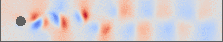
*ρ(wgpu) − ρ(reference), range ±1.19e-6 (lattice units)*

![|u(wgpu) − u(reference)|, range [0, 1.94e-5] (lattice units)](cylinder-re100-wgpu-u-diff.png)
*|u(wgpu) − u(reference)|, range [0, 1.94e-5] (lattice units)*

### Diagnostics after the last step

| Quantity | cpu | cuda | wgpu |
|----------|---|---|---|
| mass Σρ (lattice) | 3.578998346e4 | 3.578998346e4 | 3.578998428e4 |
| kinetic energy (lattice) | 6.905224063e1 | 6.905224068e1 | 6.905217780e1 |
| max \|u\| (m/s) | 2.200332095e0 | 2.200332144e0 | 2.200322924e0 |

### Forces after the last step (N/m)

| Element | Backend | Fx | Fy |
|---------|---------|----|----|
| Channel walls | cpu | 8.999449e-2 | -5.432661e-2 |
| Channel walls | cuda | 8.999449e-2 | -5.432661e-2 |
| Channel walls | wgpu | 8.999510e-2 | -5.431698e-2 |
| Inlet | cpu | -7.298761e-1 | -5.734119e-4 |
| Inlet | cuda | -7.298761e-1 | -5.734119e-4 |
| Inlet | wgpu | -7.298807e-1 | -5.733960e-4 |
| Cylinder | cpu | 1.625472e-1 | 4.657869e-2 |
| Cylinder | cuda | 1.625472e-1 | 4.657869e-2 |
| Cylinder | wgpu | 1.625470e-1 | 4.657467e-2 |

### Force statistics from t = 10.00 s

Coefficients C = 2F/(ρ₀U²L) and St = fL/U with L = 0.1000 m, U = 1.000 m/s.

| Element | Backend | Fx mean | Fx min | Fx max | Fy mean | Fy min | Fy max | C_x mean | C_x max | C_y max | f (Hz) | St |
|---------|---------|---------|--------|--------|---------|--------|--------|----------|---------|---------|--------|----|
| Channel walls | cpu | 9.03762e-2 | 8.92686e-2 | 9.14828e-2 | 2.26032e-3 | -7.56795e-2 | 7.80132e-2 | 1.808 | 1.830 | 1.560 | 2.96227 | 0.29623 |
| Channel walls | cuda | 9.03762e-2 | 8.92686e-2 | 9.14828e-2 | 2.26032e-3 | -7.56795e-2 | 7.80132e-2 | 1.808 | 1.830 | 1.560 | 2.96227 | 0.29623 |
| Channel walls | wgpu | 9.03767e-2 | 8.92691e-2 | 9.14832e-2 | 2.26033e-3 | -7.56795e-2 | 7.80120e-2 | 1.808 | 1.830 | 1.560 | 2.96227 | 0.29623 |
| Inlet | cpu | -7.58865e-1 | -7.99107e-1 | -7.21980e-1 | -9.36355e-5 | -6.67001e-4 | 4.71897e-4 | -15.18 | -14.44 | 0.009438 | 5.93116 | 0.59312 |
| Inlet | cuda | -7.58865e-1 | -7.99107e-1 | -7.21980e-1 | -9.36355e-5 | -6.67001e-4 | 4.71897e-4 | -15.18 | -14.44 | 0.009438 | 5.93116 | 0.59312 |
| Inlet | wgpu | -7.58868e-1 | -7.99110e-1 | -7.21984e-1 | -9.36344e-5 | -6.66975e-4 | 4.71898e-4 | -15.18 | -14.44 | 0.009438 | 5.93115 | 0.59312 |
| Cylinder | cpu | 1.65176e-1 | 1.62181e-1 | 1.68307e-1 | -1.29855e-3 | -5.26043e-2 | 5.06949e-2 | 3.304 | 3.366 | 1.014 | 2.96239 | 0.29624 |
| Cylinder | cuda | 1.65176e-1 | 1.62181e-1 | 1.68307e-1 | -1.29855e-3 | -5.26043e-2 | 5.06949e-2 | 3.304 | 3.366 | 1.014 | 2.96239 | 0.29624 |
| Cylinder | wgpu | 1.65176e-1 | 1.62180e-1 | 1.68307e-1 | -1.29859e-3 | -5.26039e-2 | 5.06946e-2 | 3.304 | 3.366 | 1.014 | 2.96238 | 0.29624 |

### Reference fields and time series

![Reference speed (m/s), range [4.5660e-4, 2.2003e0]](cylinder-re100-reference-speed.png)
*Reference speed (m/s), range [4.5660e-4, 2.2003e0]*

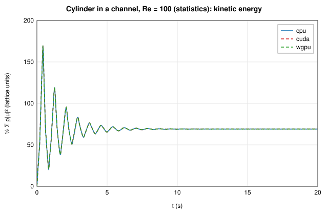

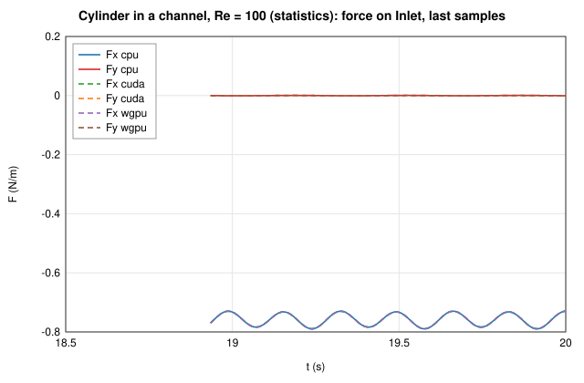

## Differentially heated cavity, Ra = 1e3 — ✅ pass

64² cavity, Pr = 0.71, buoyancy lattice velocity 0.08, 20000 steps.

Grid 66×64 (4096 fluid cells, thermal), 20000 steps (t = 25.00 s, dt = 0.001250 s), fields mode, field tolerance 1.00e-5.

### Backends

| Backend | Device | Steps | Time | MLUPS | Result |
|---------|--------|-------|------|-------|--------|
| cpu | cpu | 20000 | 1.73 s | 47 | reference |
| cuda | cuda (NVIDIA GeForce RTX 4060 (CUDA, sm_89, 8.0 GiB, driver 13.4, NVRTC 13.4)) | 20000 | 0.33 s | 247 | ✅ bit-identical |
| wgpu | wgpu (NVIDIA GeForce RTX 4060 (Vulkan, DiscreteGpu)) | 20000 | 0.19 s | 432 | ✅ max diff 4.61e-6 |

### cuda vs cpu

**Lattice fields** (pass/fail on the 04 §7 metric)

| Field | Max abs. diff | Rel. L2 | 04 §7 metric | Limit | Bit-identical |
|-------|---------------|---------|--------------|-------|---------------|
| ρ | 0 | 0 | 0 | 1.00e-5 | yes |
| ux | 0 | 0 | 0 | 1.00e-5 | yes |
| uy | 0 | 0 | 0 | 1.00e-5 | yes |
| θ | 0 | 0 | 0 | 1.00e-5 | yes |

**Output fields** (physical units, information)

| Field | Unit | Max abs. diff | Rel. L2 | Bit-identical |
|-------|------|---------------|---------|---------------|
| speed | m/s | 0 | 0 | yes |
| pressure | Pa | 0 | 0 | yes |
| vorticity | 1/s | 0 | 0 | yes |
| temperature | K | 0 | 0 | yes |

**Checks**

| Check | Value | Reference | Error | Limit | Result |
|-------|-------|-----------|-------|-------|--------|
| ρ (04 §7, absolute) | 0 | cpu | 0 | 1.00e-5 | ✅ pass |
| ux (04 §7, relative to the field maximum) | 0 | cpu | 0 | 1.00e-5 | ✅ pass |
| uy (04 §7, relative to the field maximum) | 0 | cpu | 0 | 1.00e-5 | ✅ pass |
| θ (04 §7, relative to the field maximum) | 0 | cpu | 0 | 1.00e-5 | ✅ pass |
| mass Σρ (relative; closed domain) | 4096 | 4096 | 0 | 1.00e-7 | ✅ pass |
| kinetic energy (relative) | 0.1078 | 0.1078 | 7.07e-9 |  | info |
| max \|u\| (relative) | 0.1390 | 0.1390 | 3.35e-8 |  | info |
| thermal energy Σθ (per fluid cell) | 5.913e-5 | 5.644e-5 | 6.57e-10 |  | info |
| force on domain edges (relative to the largest force) | 2.974e-7 | \|F\| = 2.974e-7 | 0 |  | info |
| force on Hot wall (relative to the largest force) | 0.02886 | \|F\| = 0.02886 | 0 |  | info |
| force on Cold wall (relative to the largest force) | 0.02886 | \|F\| = 0.02886 | 0 |  | info |

### wgpu vs cpu

**Lattice fields** (pass/fail on the 04 §7 metric)

| Field | Max abs. diff | Rel. L2 | 04 §7 metric | Limit | Bit-identical |
|-------|---------------|---------|--------------|-------|---------------|
| ρ | 1.19e-7 | 1.26e-5 | 1.19e-7 | 1.00e-5 | no |
| ux | 5.12e-8 | 3.37e-6 | 4.61e-6 | 1.00e-5 | no |
| uy | 4.10e-8 | 2.80e-6 | 3.69e-6 | 1.00e-5 | no |
| θ | 3.24e-7 | 5.29e-7 | 6.55e-7 | 1.00e-5 | no |

**Output fields** (physical units, information)

| Field | Unit | Max abs. diff | Rel. L2 | Bit-identical |
|-------|------|---------------|---------|---------------|
| speed | m/s | 6.85e-7 | 2.90e-6 | no |
| pressure | Pa | 6.44e-6 | 1.92e-7 | no |
| vorticity | 1/s | 8.14e-6 | 3.90e-6 | no |
| temperature | K | 3.05e-5 | 7.05e-6 | no |

**Checks**

| Check | Value | Reference | Error | Limit | Result |
|-------|-------|-----------|-------|-------|--------|
| ρ (04 §7, absolute) | 1.192e-7 | cpu | 1.19e-7 | 1.00e-5 | ✅ pass |
| ux (04 §7, relative to the field maximum) | 4.610e-6 | cpu | 4.61e-6 | 1.00e-5 | ✅ pass |
| uy (04 §7, relative to the field maximum) | 3.688e-6 | cpu | 3.69e-6 | 1.00e-5 | ✅ pass |
| θ (04 §7, relative to the field maximum) | 6.553e-7 | cpu | 6.55e-7 | 1.00e-5 | ✅ pass |
| mass Σρ (relative; closed domain) | 4096 | 4096 | 3.06e-10 | 1.00e-7 | ✅ pass |
| kinetic energy (relative) | 0.1078 | 0.1078 | 4.89e-6 |  | info |
| max \|u\| (relative) | 0.1390 | 0.1390 | 2.21e-6 |  | info |
| thermal energy Σθ (per fluid cell) | -1.979e-5 | 5.644e-5 | 1.86e-8 |  | info |
| force on domain edges (relative to the largest force) | 1.032e-7 | \|F\| = 2.974e-7 | 6.76e-6 |  | info |
| force on Hot wall (relative to the largest force) | 0.02886 | \|F\| = 0.02886 | 8.34e-6 |  | info |
| force on Cold wall (relative to the largest force) | 0.02886 | \|F\| = 0.02886 | 1.83e-6 |  | info |

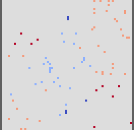
*ρ(wgpu) − ρ(reference), range ±1.19e-7 (lattice units)*

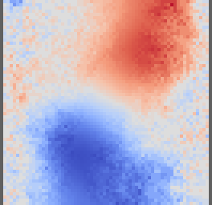
*θ(wgpu) − θ(reference), range ±3.24e-7 (lattice units)*

![|u(wgpu) − u(reference)|, range [0, 5.60e-8] (lattice units)](heated-cavity-ra1e3-wgpu-u-diff.png)
*|u(wgpu) − u(reference)|, range [0, 5.60e-8] (lattice units)*

### Diagnostics after the last step

| Quantity | cpu | cuda | wgpu |
|----------|---|---|---|
| mass Σρ (lattice) | 4.095999997e3 | 4.095999997e3 | 4.095999998e3 |
| kinetic energy (lattice) | 1.078079714e-1 | 1.078079722e-1 | 1.078084986e-1 |
| max \|u\| (m/s) | 1.389781781e-1 | 1.389781828e-1 | 1.389784855e-1 |
| thermal energy Σθ (lattice) | 5.643596523e-5 | 5.912780762e-5 | -1.978874207e-5 |

### Forces after the last step (N/m)

| Element | Backend | Fx | Fy |
|---------|---------|----|----|
| domain edges | cpu | 1.112027e-8 | -2.971670e-7 |
| domain edges | cuda | 1.112027e-8 | -2.971670e-7 |
| domain edges | wgpu | -1.808831e-9 | -1.031683e-7 |
| Hot wall | cpu | -3.100036e-3 | 2.869676e-2 |
| Hot wall | cuda | -3.100036e-3 | 2.869676e-2 |
| Hot wall | wgpu | -3.099796e-3 | 2.869681e-2 |
| Cold wall | cpu | 3.099966e-3 | -2.869675e-2 |
| Cold wall | cuda | 3.099966e-3 | -2.869675e-2 |
| Cold wall | wgpu | 3.100019e-3 | -2.869680e-2 |

### Force statistics from t = 12.50 s (information)

Coefficients C = 2F/(ρ₀U²L) and St = fL/U with L = 1.000 m, U = 1.000 m/s.

| Element | Backend | Fx mean | Fx min | Fx max | Fy mean | Fy min | Fy max | C_x mean | C_x max | C_y max | f (Hz) | St |
|---------|---------|---------|--------|--------|---------|--------|--------|----------|---------|---------|--------|----|
| domain edges | cpu | 5.59658e-9 | -1.23443e-8 | 1.70816e-8 | 3.40240e-8 | -2.98935e-7 | 3.00567e-7 | 1.119e-8 | 3.416e-8 | 6.011e-7 | 0.67823 | 0.67823 |
| domain edges | cuda | 5.59658e-9 | -1.23443e-8 | 1.70816e-8 | 3.40240e-8 | -2.98935e-7 | 3.00567e-7 | 1.119e-8 | 3.416e-8 | 6.011e-7 | 0.67823 | 0.67823 |
| domain edges | wgpu | -4.75257e-10 | -7.26835e-9 | 1.24339e-8 | -1.02043e-7 | -2.10282e-7 | 1.29729e-7 | -9.505e-10 | 2.487e-8 | 2.595e-7 | 0.87596 | 0.87596 |
| Hot wall | cpu | -3.09980e-3 | -3.10004e-3 | -3.09963e-3 | 2.86968e-2 | 2.86967e-2 | 2.86968e-2 | -0.006200 | -0.006199 | 0.05739 | — | — |
| Hot wall | cuda | -3.09980e-3 | -3.10004e-3 | -3.09963e-3 | 2.86968e-2 | 2.86967e-2 | 2.86968e-2 | -0.006200 | -0.006199 | 0.05739 | — | — |
| Hot wall | wgpu | -3.09990e-3 | -3.10001e-3 | -3.09978e-3 | 2.86968e-2 | 2.86968e-2 | 2.86969e-2 | -0.006200 | -0.006200 | 0.05739 | — | — |
| Cold wall | cpu | 3.09975e-3 | 3.09957e-3 | 3.09997e-3 | -2.86968e-2 | -2.86968e-2 | -2.86968e-2 | 0.006200 | 0.006200 | -0.05739 | — | — |
| Cold wall | cuda | 3.09975e-3 | 3.09957e-3 | 3.09997e-3 | -2.86968e-2 | -2.86968e-2 | -2.86968e-2 | 0.006200 | 0.006200 | -0.05739 | — | — |
| Cold wall | wgpu | 3.09991e-3 | 3.09979e-3 | 3.10003e-3 | -2.86968e-2 | -2.86969e-2 | -2.86968e-2 | 0.006200 | 0.006200 | -0.05739 | — | — |

### Reference fields and time series

![Reference speed (m/s), range [1.0954e-6, 1.3898e-1]](heated-cavity-ra1e3-reference-speed.png)
*Reference speed (m/s), range [1.0954e-6, 1.3898e-1]*

![Reference temperature (K), range [3.0001e2, 3.0099e2]](heated-cavity-ra1e3-reference-temperature.png)
*Reference temperature (K), range [3.0001e2, 3.0099e2]*

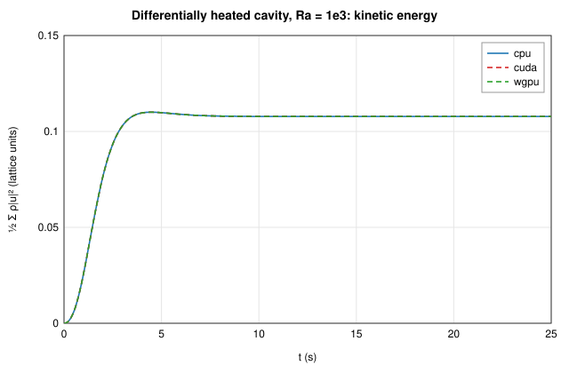

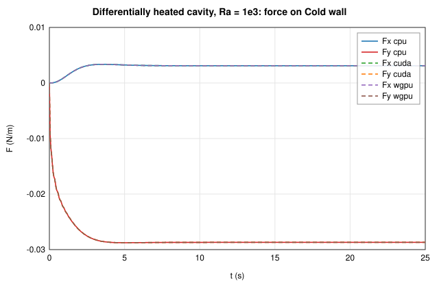

## Differentially heated cavity, Ra = 1e4 — ✅ pass

64² cavity, Pr = 0.71, buoyancy lattice velocity 0.08, 20000 steps.

Grid 66×64 (4096 fluid cells, thermal), 20000 steps (t = 25.00 s, dt = 0.001250 s), fields mode, field tolerance 1.00e-5.

### Backends

| Backend | Device | Steps | Time | MLUPS | Result |
|---------|--------|-------|------|-------|--------|
| cpu | cpu | 20000 | 1.69 s | 48 | reference |
| cuda | cuda (NVIDIA GeForce RTX 4060 (CUDA, sm_89, 8.0 GiB, driver 13.4, NVRTC 13.4)) | 20000 | 0.27 s | 299 | ✅ bit-identical |
| wgpu | wgpu (NVIDIA GeForce RTX 4060 (Vulkan, DiscreteGpu)) | 20000 | 0.24 s | 347 | ✅ max diff 4.14e-6 |

### cuda vs cpu

**Lattice fields** (pass/fail on the 04 §7 metric)

| Field | Max abs. diff | Rel. L2 | 04 §7 metric | Limit | Bit-identical |
|-------|---------------|---------|--------------|-------|---------------|
| ρ | 0 | 0 | 0 | 1.00e-5 | yes |
| ux | 0 | 0 | 0 | 1.00e-5 | yes |
| uy | 0 | 0 | 0 | 1.00e-5 | yes |
| θ | 0 | 0 | 0 | 1.00e-5 | yes |

**Output fields** (physical units, information)

| Field | Unit | Max abs. diff | Rel. L2 | Bit-identical |
|-------|------|---------------|---------|---------------|
| speed | m/s | 0 | 0 | yes |
| pressure | Pa | 0 | 0 | yes |
| vorticity | 1/s | 0 | 0 | yes |
| temperature | K | 0 | 0 | yes |

**Checks**

| Check | Value | Reference | Error | Limit | Result |
|-------|-------|-----------|-------|-------|--------|
| ρ (04 §7, absolute) | 0 | cpu | 0 | 1.00e-5 | ✅ pass |
| ux (04 §7, relative to the field maximum) | 0 | cpu | 0 | 1.00e-5 | ✅ pass |
| uy (04 §7, relative to the field maximum) | 0 | cpu | 0 | 1.00e-5 | ✅ pass |
| θ (04 §7, relative to the field maximum) | 0 | cpu | 0 | 1.00e-5 | ✅ pass |
| mass Σρ (relative; closed domain) | 4096 | 4096 | 0 | 1.00e-7 | ✅ pass |
| kinetic energy (relative) | 0.2395 | 0.2395 | 3.40e-10 |  | info |
| max \|u\| (relative) | 0.2337 | 0.2337 | 2.41e-8 |  | info |
| thermal energy Σθ (per fluid cell) | -5.245e-5 | -5.921e-5 | 1.65e-9 |  | info |
| force on domain edges (relative to the largest force) | 1.862e-7 | \|F\| = 1.862e-7 | 0 |  | info |
| force on Hot wall (relative to the largest force) | 0.02545 | \|F\| = 0.02545 | 0 |  | info |
| force on Cold wall (relative to the largest force) | 0.02545 | \|F\| = 0.02545 | 0 |  | info |

### wgpu vs cpu

**Lattice fields** (pass/fail on the 04 §7 metric)

| Field | Max abs. diff | Rel. L2 | 04 §7 metric | Limit | Bit-identical |
|-------|---------------|---------|--------------|-------|---------------|
| ρ | 1.19e-7 | 1.61e-5 | 1.19e-7 | 1.00e-5 | no |
| ux | 7.73e-8 | 3.26e-6 | 4.14e-6 | 1.00e-5 | no |
| uy | 4.84e-8 | 1.86e-6 | 2.59e-6 | 1.00e-5 | no |
| θ | 5.74e-7 | 9.10e-7 | 1.16e-6 | 1.00e-5 | no |

**Output fields** (physical units, information)

| Field | Unit | Max abs. diff | Rel. L2 | Bit-identical |
|-------|------|---------------|---------|---------------|
| speed | m/s | 9.09e-7 | 2.48e-6 | no |
| pressure | Pa | 6.20e-6 | 2.19e-7 | no |
| vorticity | 1/s | 1.58e-5 | 4.15e-6 | no |
| temperature | K | 3.05e-5 | 9.77e-6 | no |

**Checks**

| Check | Value | Reference | Error | Limit | Result |
|-------|-------|-----------|-------|-------|--------|
| ρ (04 §7, absolute) | 1.192e-7 | cpu | 1.19e-7 | 1.00e-5 | ✅ pass |
| ux (04 §7, relative to the field maximum) | 4.138e-6 | cpu | 4.14e-6 | 1.00e-5 | ✅ pass |
| uy (04 §7, relative to the field maximum) | 2.592e-6 | cpu | 2.59e-6 | 1.00e-5 | ✅ pass |
| θ (04 §7, relative to the field maximum) | 1.158e-6 | cpu | 1.16e-6 | 1.00e-5 | ✅ pass |
| mass Σρ (relative; closed domain) | 4096 | 4096 | 4.80e-10 | 1.00e-7 | ✅ pass |
| kinetic energy (relative) | 0.2395 | 0.2395 | 3.35e-6 |  | info |
| max \|u\| (relative) | 0.2337 | 0.2337 | 2.27e-6 |  | info |
| thermal energy Σθ (per fluid cell) | 6.151e-5 | -5.921e-5 | 2.95e-8 |  | info |
| force on domain edges (relative to the largest force) | 5.073e-8 | \|F\| = 1.862e-7 | 5.63e-6 |  | info |
| force on Hot wall (relative to the largest force) | 0.02545 | \|F\| = 0.02545 | 1.19e-5 |  | info |
| force on Cold wall (relative to the largest force) | 0.02545 | \|F\| = 0.02545 | 9.83e-6 |  | info |

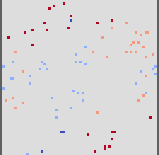
*ρ(wgpu) − ρ(reference), range ±1.19e-7 (lattice units)*

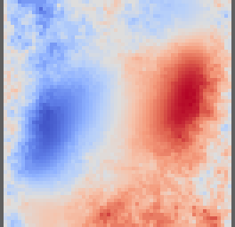
*θ(wgpu) − θ(reference), range ±5.74e-7 (lattice units)*

![|u(wgpu) − u(reference)|, range [0, 7.75e-8] (lattice units)](heated-cavity-ra1e4-wgpu-u-diff.png)
*|u(wgpu) − u(reference)|, range [0, 7.75e-8] (lattice units)*

### Diagnostics after the last step

| Quantity | cpu | cuda | wgpu |
|----------|---|---|---|
| mass Σρ (lattice) | 4.095999999e3 | 4.095999999e3 | 4.096000001e3 |
| kinetic energy (lattice) | 2.394605466e-1 | 2.394605465e-1 | 2.394613497e-1 |
| max \|u\| (m/s) | 2.336999225e-1 | 2.336999169e-1 | 2.337004524e-1 |
| thermal energy Σθ (lattice) | -5.920534022e-5 | -5.245208740e-5 | 6.151199341e-5 |

### Forces after the last step (N/m)

| Element | Backend | Fx | Fy |
|---------|---------|----|----|
| domain edges | cpu | 5.063727e-9 | 1.861145e-7 |
| domain edges | cuda | 5.063727e-9 | 1.861145e-7 |
| domain edges | wgpu | 5.823120e-10 | 5.072665e-8 |
| Hot wall | cpu | -8.292938e-3 | 2.406026e-2 |
| Hot wall | cuda | -8.292938e-3 | 2.406026e-2 |
| Hot wall | wgpu | -8.293225e-3 | 2.406029e-2 |
| Cold wall | cpu | 8.293042e-3 | -2.406026e-2 |
| Cold wall | cuda | 8.293042e-3 | -2.406026e-2 |
| Cold wall | wgpu | 8.293279e-3 | -2.406029e-2 |

### Force statistics from t = 12.50 s (information)

Coefficients C = 2F/(ρ₀U²L) and St = fL/U with L = 1.000 m, U = 1.000 m/s.

| Element | Backend | Fx mean | Fx min | Fx max | Fy mean | Fy min | Fy max | C_x mean | C_x max | C_y max | f (Hz) | St |
|---------|---------|---------|--------|--------|---------|--------|--------|----------|---------|---------|--------|----|
| domain edges | cpu | 1.98794e-10 | -3.98126e-9 | 6.17117e-9 | 4.04675e-8 | -1.31075e-7 | 3.42892e-7 | 3.976e-10 | 1.234e-8 | 6.858e-7 | 1.88532 | 1.88532 |
| domain edges | cuda | 1.98794e-10 | -3.98126e-9 | 6.17117e-9 | 4.04675e-8 | -1.31075e-7 | 3.42892e-7 | 3.976e-10 | 1.234e-8 | 6.858e-7 | 1.88532 | 1.88532 |
| domain edges | wgpu | -4.68012e-10 | -4.97546e-9 | 4.26770e-9 | -7.09755e-8 | -2.56212e-7 | 1.43651e-7 | -9.360e-10 | 8.535e-9 | 2.873e-7 | 2.17340 | 2.17340 |
| Hot wall | cpu | -8.31327e-3 | -8.37527e-3 | -8.28952e-3 | 2.40635e-2 | 2.40289e-2 | 2.40805e-2 | -0.01663 | -0.01658 | 0.04816 | — | — |
| Hot wall | cuda | -8.31327e-3 | -8.37527e-3 | -8.28952e-3 | 2.40635e-2 | 2.40289e-2 | 2.40805e-2 | -0.01663 | -0.01658 | 0.04816 | — | — |
| Hot wall | wgpu | -8.31352e-3 | -8.37551e-3 | -8.28973e-3 | 2.40636e-2 | 2.40290e-2 | 2.40805e-2 | -0.01663 | -0.01658 | 0.04816 | — | — |
| Cold wall | cpu | 8.31327e-3 | 8.28943e-3 | 8.37530e-3 | -2.40635e-2 | -2.40805e-2 | -2.40289e-2 | 0.01663 | 0.01675 | -0.04806 | — | — |
| Cold wall | cuda | 8.31327e-3 | 8.28943e-3 | 8.37530e-3 | -2.40635e-2 | -2.40805e-2 | -2.40289e-2 | 0.01663 | 0.01675 | -0.04806 | — | — |
| Cold wall | wgpu | 8.31354e-3 | 8.28973e-3 | 8.37548e-3 | -2.40636e-2 | -2.40805e-2 | -2.40290e-2 | 0.01663 | 0.01675 | -0.04806 | — | — |

### Reference fields and time series

![Reference speed (m/s), range [1.9827e-5, 2.3370e-1]](heated-cavity-ra1e4-reference-speed.png)
*Reference speed (m/s), range [1.9827e-5, 2.3370e-1]*

![Reference temperature (K), range [3.0000e2, 3.0100e2]](heated-cavity-ra1e4-reference-temperature.png)
*Reference temperature (K), range [3.0000e2, 3.0100e2]*

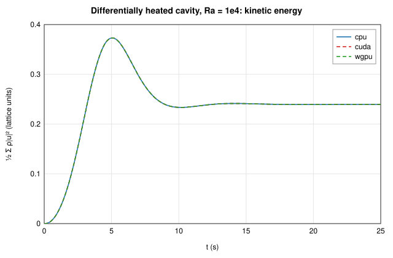

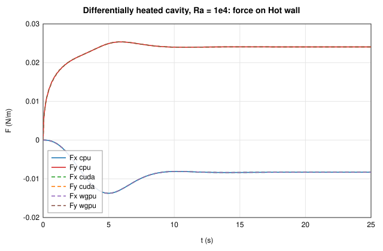

## Differentially heated cavity, Ra = 1e5 — ✅ pass

64² cavity, Pr = 0.71, buoyancy lattice velocity 0.08, 20000 steps.

Grid 66×64 (4096 fluid cells, thermal), 20000 steps (t = 25.00 s, dt = 0.001250 s), fields mode, field tolerance 1.00e-5.

### Backends

| Backend | Device | Steps | Time | MLUPS | Result |
|---------|--------|-------|------|-------|--------|
| cpu | cpu | 20000 | 1.85 s | 44 | reference |
| cuda | cuda (NVIDIA GeForce RTX 4060 (CUDA, sm_89, 8.0 GiB, driver 13.4, NVRTC 13.4)) | 20000 | 0.31 s | 265 | ✅ bit-identical |
| wgpu | wgpu (NVIDIA GeForce RTX 4060 (Vulkan, DiscreteGpu)) | 20000 | 0.20 s | 403 | ✅ max diff 1.80e-6 |

### cuda vs cpu

**Lattice fields** (pass/fail on the 04 §7 metric)

| Field | Max abs. diff | Rel. L2 | 04 §7 metric | Limit | Bit-identical |
|-------|---------------|---------|--------------|-------|---------------|
| ρ | 0 | 0 | 0 | 1.00e-5 | yes |
| ux | 0 | 0 | 0 | 1.00e-5 | yes |
| uy | 0 | 0 | 0 | 1.00e-5 | yes |
| θ | 0 | 0 | 0 | 1.00e-5 | yes |

**Output fields** (physical units, information)

| Field | Unit | Max abs. diff | Rel. L2 | Bit-identical |
|-------|------|---------------|---------|---------------|
| speed | m/s | 0 | 0 | yes |
| pressure | Pa | 0 | 0 | yes |
| vorticity | 1/s | 0 | 0 | yes |
| temperature | K | 0 | 0 | yes |

**Checks**

| Check | Value | Reference | Error | Limit | Result |
|-------|-------|-----------|-------|-------|--------|
| ρ (04 §7, absolute) | 0 | cpu | 0 | 1.00e-5 | ✅ pass |
| ux (04 §7, relative to the field maximum) | 0 | cpu | 0 | 1.00e-5 | ✅ pass |
| uy (04 §7, relative to the field maximum) | 0 | cpu | 0 | 1.00e-5 | ✅ pass |
| θ (04 §7, relative to the field maximum) | 0 | cpu | 0 | 1.00e-5 | ✅ pass |
| mass Σρ (relative; closed domain) | 4096 | 4096 | 0 | 1.00e-7 | ✅ pass |
| kinetic energy (relative) | 0.1636 | 0.1636 | 1.19e-8 |  | info |
| max \|u\| (relative) | 0.2582 | 0.2582 | 7.28e-9 |  | info |
| thermal energy Σθ (per fluid cell) | 3.147e-5 | 2.794e-5 | 8.62e-10 |  | info |
| force on domain edges (relative to the largest force) | 2.779e-8 | \|F\| = 2.779e-8 | 0 |  | info |
| force on Hot wall (relative to the largest force) | 0.01731 | \|F\| = 0.01731 | 0 |  | info |
| force on Cold wall (relative to the largest force) | 0.01731 | \|F\| = 0.01731 | 0 |  | info |

### wgpu vs cpu

**Lattice fields** (pass/fail on the 04 §7 metric)

| Field | Max abs. diff | Rel. L2 | 04 §7 metric | Limit | Bit-identical |
|-------|---------------|---------|--------------|-------|---------------|
| ρ | 1.19e-7 | 1.52e-5 | 1.19e-7 | 1.00e-5 | no |
| ux | 3.73e-8 | 2.64e-6 | 1.80e-6 | 1.00e-5 | no |
| uy | 1.98e-8 | 1.05e-6 | 9.58e-7 | 1.00e-5 | no |
| θ | 4.69e-7 | 5.88e-7 | 9.49e-7 | 1.00e-5 | no |

**Output fields** (physical units, information)

| Field | Unit | Max abs. diff | Rel. L2 | Bit-identical |
|-------|------|---------------|---------|---------------|
| speed | m/s | 4.99e-7 | 1.77e-6 | no |
| pressure | Pa | 6.20e-6 | 1.76e-7 | no |
| vorticity | 1/s | 1.25e-5 | 2.31e-6 | no |
| temperature | K | 3.05e-5 | 6.22e-6 | no |

**Checks**

| Check | Value | Reference | Error | Limit | Result |
|-------|-------|-----------|-------|-------|--------|
| ρ (04 §7, absolute) | 1.192e-7 | cpu | 1.19e-7 | 1.00e-5 | ✅ pass |
| ux (04 §7, relative to the field maximum) | 1.804e-6 | cpu | 1.80e-6 | 1.00e-5 | ✅ pass |
| uy (04 §7, relative to the field maximum) | 9.585e-7 | cpu | 9.58e-7 | 1.00e-5 | ✅ pass |
| θ (04 §7, relative to the field maximum) | 9.488e-7 | cpu | 9.49e-7 | 1.00e-5 | ✅ pass |
| mass Σρ (relative; closed domain) | 4096 | 4096 | 0 | 1.00e-7 | ✅ pass |
| kinetic energy (relative) | 0.1636 | 0.1636 | 1.54e-8 |  | info |
| max \|u\| (relative) | 0.2582 | 0.2582 | 7.29e-7 |  | info |
| thermal energy Σθ (per fluid cell) | -6.390e-5 | 2.794e-5 | 2.24e-8 |  | info |
| force on domain edges (relative to the largest force) | 6.136e-8 | \|F\| = 2.779e-8 | 5.39e-6 |  | info |
| force on Hot wall (relative to the largest force) | 0.01731 | \|F\| = 0.01731 | 5.87e-6 |  | info |
| force on Cold wall (relative to the largest force) | 0.01731 | \|F\| = 0.01731 | 3.98e-6 |  | info |

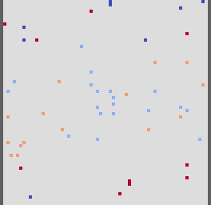
*ρ(wgpu) − ρ(reference), range ±1.19e-7 (lattice units)*

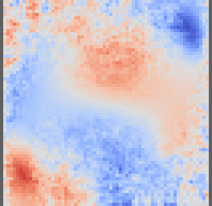
*θ(wgpu) − θ(reference), range ±4.69e-7 (lattice units)*

![|u(wgpu) − u(reference)|, range [0, 3.97e-8] (lattice units)](heated-cavity-ra1e5-wgpu-u-diff.png)
*|u(wgpu) − u(reference)|, range [0, 3.97e-8] (lattice units)*

### Diagnostics after the last step

| Quantity | cpu | cuda | wgpu |
|----------|---|---|---|
| mass Σρ (lattice) | 4.095999999e3 | 4.095999999e3 | 4.095999999e3 |
| kinetic energy (lattice) | 1.636091312e-1 | 1.636091332e-1 | 1.636091337e-1 |
| max \|u\| (m/s) | 2.581671094e-1 | 2.581671113e-1 | 2.581672976e-1 |
| thermal energy Σθ (lattice) | 2.794165630e-5 | 3.147125244e-5 | -6.389617920e-5 |

### Forces after the last step (N/m)

| Element | Backend | Fx | Fy |
|---------|---------|----|----|
| domain edges | cpu | -8.282264e-10 | 2.778000e-8 |
| domain edges | cuda | -8.282264e-10 | 2.778000e-8 |
| domain edges | wgpu | 5.884182e-10 | -6.135314e-8 |
| Hot wall | cpu | -5.152948e-3 | 1.652395e-2 |
| Hot wall | cuda | -5.152948e-3 | 1.652395e-2 |
| Hot wall | wgpu | -5.152852e-3 | 1.652394e-2 |
| Cold wall | cpu | 5.152954e-3 | -1.652395e-2 |
| Cold wall | cuda | 5.152954e-3 | -1.652395e-2 |
| Cold wall | wgpu | 5.153020e-3 | -1.652395e-2 |

### Force statistics from t = 12.50 s (information)

Coefficients C = 2F/(ρ₀U²L) and St = fL/U with L = 1.000 m, U = 1.000 m/s.

| Element | Backend | Fx mean | Fx min | Fx max | Fy mean | Fy min | Fy max | C_x mean | C_x max | C_y max | f (Hz) | St |
|---------|---------|---------|--------|--------|---------|--------|--------|----------|---------|---------|--------|----|
| domain edges | cpu | 8.54783e-11 | -4.94493e-9 | 8.53317e-9 | 4.22278e-8 | -1.54621e-7 | 3.05036e-7 | 1.710e-10 | 1.707e-8 | 6.101e-7 | 1.64490 | 1.64490 |
| domain edges | cuda | 8.54783e-11 | -4.94493e-9 | 8.53317e-9 | 4.22278e-8 | -1.54621e-7 | 3.05036e-7 | 1.710e-10 | 1.707e-8 | 6.101e-7 | 1.64490 | 1.64490 |
| domain edges | wgpu | -2.23389e-10 | -4.52527e-9 | 4.99378e-9 | -1.86610e-8 | -1.05014e-7 | 1.39606e-7 | -4.468e-10 | 9.988e-9 | 2.792e-7 | 1.30044 | 1.30044 |
| Hot wall | cpu | -5.36535e-3 | -6.18511e-3 | -4.68293e-3 | 1.65430e-2 | 1.64135e-2 | 1.66530e-2 | -0.01073 | -0.009366 | 0.03331 | — | — |
| Hot wall | cuda | -5.36535e-3 | -6.18511e-3 | -4.68293e-3 | 1.65430e-2 | 1.64135e-2 | 1.66530e-2 | -0.01073 | -0.009366 | 0.03331 | — | — |
| Hot wall | wgpu | -5.36530e-3 | -6.18497e-3 | -4.68285e-3 | 1.65430e-2 | 1.64135e-2 | 1.66530e-2 | -0.01073 | -0.009366 | 0.03331 | — | — |
| Cold wall | cpu | 5.36531e-3 | 4.68282e-3 | 6.18499e-3 | -1.65430e-2 | -1.66530e-2 | -1.64135e-2 | 0.01073 | 0.01237 | -0.03283 | — | — |
| Cold wall | cuda | 5.36531e-3 | 4.68282e-3 | 6.18499e-3 | -1.65430e-2 | -1.66530e-2 | -1.64135e-2 | 0.01073 | 0.01237 | -0.03283 | — | — |
| Cold wall | wgpu | 5.36530e-3 | 4.68278e-3 | 6.18509e-3 | -1.65430e-2 | -1.66530e-2 | -1.64135e-2 | 0.01073 | 0.01237 | -0.03283 | — | — |

### Reference fields and time series

![Reference speed (m/s), range [1.6674e-4, 2.5817e-1]](heated-cavity-ra1e5-reference-speed.png)
*Reference speed (m/s), range [1.6674e-4, 2.5817e-1]*

![Reference temperature (K), range [3.0001e2, 3.0099e2]](heated-cavity-ra1e5-reference-temperature.png)
*Reference temperature (K), range [3.0001e2, 3.0099e2]*

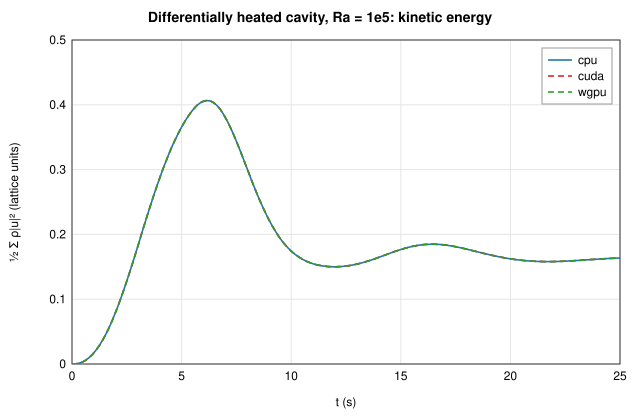

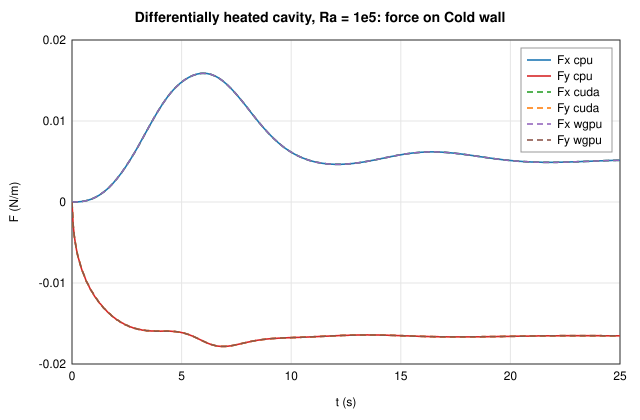

## Differentially heated cavity, Ra = 1e6 — ✅ pass

64² cavity, Pr = 0.71, buoyancy lattice velocity 0.08, 20000 steps.

Grid 66×64 (4096 fluid cells, thermal), 20000 steps (t = 25.00 s, dt = 0.001250 s), fields mode, field tolerance 1.00e-5.

### Backends

| Backend | Device | Steps | Time | MLUPS | Result |
|---------|--------|-------|------|-------|--------|
| cpu | cpu | 20000 | 1.78 s | 46 | reference |
| cuda | cuda (NVIDIA GeForce RTX 4060 (CUDA, sm_89, 8.0 GiB, driver 13.4, NVRTC 13.4)) | 20000 | 0.29 s | 283 | ✅ bit-identical |
| wgpu | wgpu (NVIDIA GeForce RTX 4060 (Vulkan, DiscreteGpu)) | 20000 | 0.26 s | 310 | ✅ max diff 1.02e-6 |

### cuda vs cpu

**Lattice fields** (pass/fail on the 04 §7 metric)

| Field | Max abs. diff | Rel. L2 | 04 §7 metric | Limit | Bit-identical |
|-------|---------------|---------|--------------|-------|---------------|
| ρ | 0 | 0 | 0 | 1.00e-5 | yes |
| ux | 0 | 0 | 0 | 1.00e-5 | yes |
| uy | 0 | 0 | 0 | 1.00e-5 | yes |
| θ | 0 | 0 | 0 | 1.00e-5 | yes |

**Output fields** (physical units, information)

| Field | Unit | Max abs. diff | Rel. L2 | Bit-identical |
|-------|------|---------------|---------|---------------|
| speed | m/s | 0 | 0 | yes |
| pressure | Pa | 0 | 0 | yes |
| vorticity | 1/s | 0 | 0 | yes |
| temperature | K | 0 | 0 | yes |

**Checks**

| Check | Value | Reference | Error | Limit | Result |
|-------|-------|-----------|-------|-------|--------|
| ρ (04 §7, absolute) | 0 | cpu | 0 | 1.00e-5 | ✅ pass |
| ux (04 §7, relative to the field maximum) | 0 | cpu | 0 | 1.00e-5 | ✅ pass |
| uy (04 §7, relative to the field maximum) | 0 | cpu | 0 | 1.00e-5 | ✅ pass |
| θ (04 §7, relative to the field maximum) | 0 | cpu | 0 | 1.00e-5 | ✅ pass |
| mass Σρ (relative; closed domain) | 4096 | 4096 | 0 | 1.00e-7 | ✅ pass |
| kinetic energy (relative) | 0.09477 | 0.09477 | 1.24e-8 |  | info |
| max \|u\| (relative) | 0.2600 | 0.2600 | 5.37e-9 |  | info |
| thermal energy Σθ (per fluid cell) | 6.914e-6 | 7.202e-6 | 7.03e-11 |  | info |
| force on domain edges (relative to the largest force) | 2.216e-8 | \|F\| = 2.216e-8 | 0 |  | info |
| force on Hot wall (relative to the largest force) | 0.01052 | \|F\| = 0.01052 | 0 |  | info |
| force on Cold wall (relative to the largest force) | 0.01052 | \|F\| = 0.01052 | 0 |  | info |

### wgpu vs cpu

**Lattice fields** (pass/fail on the 04 §7 metric)

| Field | Max abs. diff | Rel. L2 | 04 §7 metric | Limit | Bit-identical |
|-------|---------------|---------|--------------|-------|---------------|
| ρ | 1.19e-7 | 1.73e-5 | 1.19e-7 | 1.00e-5 | no |
| ux | 1.91e-8 | 1.63e-6 | 9.18e-7 | 1.00e-5 | no |
| uy | 1.37e-8 | 5.86e-7 | 6.60e-7 | 1.00e-5 | no |
| θ | 5.07e-7 | 5.50e-7 | 1.02e-6 | 1.00e-5 | no |

**Output fields** (physical units, information)

| Field | Unit | Max abs. diff | Rel. L2 | Bit-identical |
|-------|------|---------------|---------|---------------|
| speed | m/s | 2.61e-7 | 9.14e-7 | no |
| pressure | Pa | 6.44e-6 | 1.78e-7 | no |
| vorticity | 1/s | 7.09e-6 | 1.06e-6 | no |
| temperature | K | 3.05e-5 | 7.99e-6 | no |

**Checks**

| Check | Value | Reference | Error | Limit | Result |
|-------|-------|-----------|-------|-------|--------|
| ρ (04 §7, absolute) | 1.192e-7 | cpu | 1.19e-7 | 1.00e-5 | ✅ pass |
| ux (04 §7, relative to the field maximum) | 9.180e-7 | cpu | 9.18e-7 | 1.00e-5 | ✅ pass |
| uy (04 §7, relative to the field maximum) | 6.605e-7 | cpu | 6.60e-7 | 1.00e-5 | ✅ pass |
| θ (04 §7, relative to the field maximum) | 1.025e-6 | cpu | 1.02e-6 | 1.00e-5 | ✅ pass |
| mass Σρ (relative; closed domain) | 4096 | 4096 | 1.46e-10 | 1.00e-7 | ✅ pass |
| kinetic energy (relative) | 0.09477 | 0.09477 | 1.02e-7 |  | info |
| max \|u\| (relative) | 0.2600 | 0.2600 | 2.74e-7 |  | info |
| thermal energy Σθ (per fluid cell) | -1.764e-5 | 7.202e-6 | 6.07e-9 |  | info |
| force on domain edges (relative to the largest force) | 4.880e-8 | \|F\| = 2.216e-8 | 6.86e-6 |  | info |
| force on Hot wall (relative to the largest force) | 0.01052 | \|F\| = 0.01052 | 9.16e-7 |  | info |
| force on Cold wall (relative to the largest force) | 0.01052 | \|F\| = 0.01052 | 1.02e-5 |  | info |

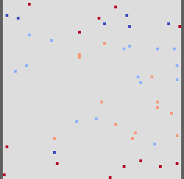
*ρ(wgpu) − ρ(reference), range ±1.19e-7 (lattice units)*

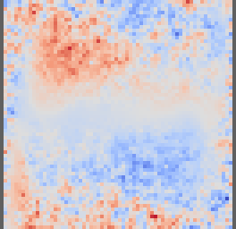
*θ(wgpu) − θ(reference), range ±5.07e-7 (lattice units)*

![|u(wgpu) − u(reference)|, range [0, 2.00e-8] (lattice units)](heated-cavity-ra1e6-wgpu-u-diff.png)
*|u(wgpu) − u(reference)|, range [0, 2.00e-8] (lattice units)*

### Diagnostics after the last step

| Quantity | cpu | cuda | wgpu |
|----------|---|---|---|
| mass Σρ (lattice) | 4.096000001e3 | 4.096000001e3 | 4.096000002e3 |
| kinetic energy (lattice) | 9.477197186e-2 | 9.477197303e-2 | 9.477196215e-2 |
| max \|u\| (m/s) | 2.599970424e-1 | 2.599970438e-1 | 2.599971136e-1 |
| thermal energy Σθ (lattice) | 7.202150300e-6 | 6.914138794e-6 | -1.764297485e-5 |

### Forces after the last step (N/m)

| Element | Backend | Fx | Fy |
|---------|---------|----|----|
| domain edges | cpu | 3.037570e-9 | -2.195577e-8 |
| domain edges | cuda | 3.037570e-9 | -2.195577e-8 |
| domain edges | wgpu | 5.249134e-9 | 4.852119e-8 |
| Hot wall | cpu | -2.276107e-3 | 1.026760e-2 |
| Hot wall | cuda | -2.276107e-3 | 1.026760e-2 |
| Hot wall | wgpu | -2.276098e-3 | 1.026761e-2 |
| Cold wall | cpu | 2.276169e-3 | -1.026763e-2 |
| Cold wall | cuda | 2.276169e-3 | -1.026763e-2 |
| Cold wall | wgpu | 2.276065e-3 | -1.026760e-2 |

### Force statistics from t = 12.50 s (information)

Coefficients C = 2F/(ρ₀U²L) and St = fL/U with L = 1.000 m, U = 1.000 m/s.

| Element | Backend | Fx mean | Fx min | Fx max | Fy mean | Fy min | Fy max | C_x mean | C_x max | C_y max | f (Hz) | St |
|---------|---------|---------|--------|--------|---------|--------|--------|----------|---------|---------|--------|----|
| domain edges | cpu | -6.04025e-9 | -3.92042e-8 | 1.56142e-8 | -4.33815e-8 | -2.39715e-7 | 1.43068e-7 | -1.208e-8 | 3.123e-8 | 2.861e-7 | 1.74124 | 1.74124 |
| domain edges | cuda | -6.04025e-9 | -3.92042e-8 | 1.56142e-8 | -4.33815e-8 | -2.39715e-7 | 1.43068e-7 | -1.208e-8 | 3.123e-8 | 2.861e-7 | 1.74124 | 1.74124 |
| domain edges | wgpu | -4.99993e-9 | -2.70450e-8 | 2.40608e-8 | -4.78098e-8 | -2.30145e-7 | 1.44773e-7 | -1.000e-8 | 4.812e-8 | 2.895e-7 | 1.22109 | 1.22109 |
| Hot wall | cpu | -3.36041e-3 | -4.39393e-3 | -2.27611e-3 | 1.03657e-2 | 1.02160e-2 | 1.06266e-2 | -0.006721 | -0.004552 | 0.02125 | — | — |
| Hot wall | cuda | -3.36041e-3 | -4.39393e-3 | -2.27611e-3 | 1.03657e-2 | 1.02160e-2 | 1.06266e-2 | -0.006721 | -0.004552 | 0.02125 | — | — |
| Hot wall | wgpu | -3.36041e-3 | -4.39395e-3 | -2.27610e-3 | 1.03657e-2 | 1.02160e-2 | 1.06266e-2 | -0.006721 | -0.004552 | 0.02125 | — | — |
| Cold wall | cpu | 3.36052e-3 | 2.27617e-3 | 4.39400e-3 | -1.03657e-2 | -1.06266e-2 | -1.02161e-2 | 0.006721 | 0.008788 | -0.02043 | — | — |
| Cold wall | cuda | 3.36052e-3 | 2.27617e-3 | 4.39400e-3 | -1.03657e-2 | -1.06266e-2 | -1.02161e-2 | 0.006721 | 0.008788 | -0.02043 | — | — |
| Cold wall | wgpu | 3.36045e-3 | 2.27606e-3 | 4.39406e-3 | -1.03657e-2 | -1.06266e-2 | -1.02161e-2 | 0.006721 | 0.008788 | -0.02043 | — | — |

### Reference fields and time series

![Reference speed (m/s), range [3.0729e-4, 2.6000e-1]](heated-cavity-ra1e6-reference-speed.png)
*Reference speed (m/s), range [3.0729e-4, 2.6000e-1]*

![Reference temperature (K), range [3.0001e2, 3.0099e2]](heated-cavity-ra1e6-reference-temperature.png)
*Reference temperature (K), range [3.0001e2, 3.0099e2]*

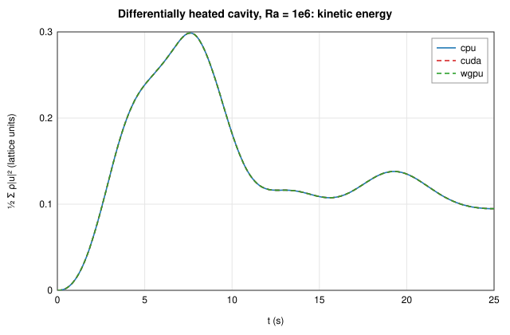

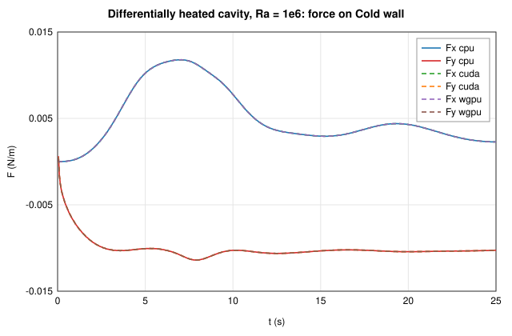

## Rayleigh-Bénard convection — ✅ pass

Layer of height 24 cells heated from below, Ra = 20000, Pr = 0.71, perturbed conduction profile, 10000 steps (convection rolls developing).

Grid 48×26 (1152 fluid cells, thermal), 10000 steps (t = 33.33 s, dt = 0.003333 s), fields mode, field tolerance 1.00e-5.

### Backends

| Backend | Device | Steps | Time | MLUPS | Result |
|---------|--------|-------|------|-------|--------|
| cpu | cpu | 10000 | 0.36 s | 32 | reference |
| cuda | cuda (NVIDIA GeForce RTX 4060 (CUDA, sm_89, 8.0 GiB, driver 13.4, NVRTC 13.4)) | 10000 | 0.11 s | 110 | ✅ bit-identical |
| wgpu | wgpu (NVIDIA GeForce RTX 4060 (Vulkan, DiscreteGpu)) | 10000 | 0.14 s | 84 | ✅ max diff 1.10e-6 |

### cuda vs cpu

**Lattice fields** (pass/fail on the 04 §7 metric)

| Field | Max abs. diff | Rel. L2 | 04 §7 metric | Limit | Bit-identical |
|-------|---------------|---------|--------------|-------|---------------|
| ρ | 0 | 0 | 0 | 1.00e-5 | yes |
| ux | 0 | 0 | 0 | 1.00e-5 | yes |
| uy | 0 | 0 | 0 | 1.00e-5 | yes |
| θ | 0 | 0 | 0 | 1.00e-5 | yes |

**Output fields** (physical units, information)

| Field | Unit | Max abs. diff | Rel. L2 | Bit-identical |
|-------|------|---------------|---------|---------------|
| speed | m/s | 0 | 0 | yes |
| pressure | Pa | 0 | 0 | yes |
| vorticity | 1/s | 0 | 0 | yes |
| temperature | K | 0 | 0 | yes |

**Checks**

| Check | Value | Reference | Error | Limit | Result |
|-------|-------|-----------|-------|-------|--------|
| ρ (04 §7, absolute) | 0 | cpu | 0 | 1.00e-5 | ✅ pass |
| ux (04 §7, relative to the field maximum) | 0 | cpu | 0 | 1.00e-5 | ✅ pass |
| uy (04 §7, relative to the field maximum) | 0 | cpu | 0 | 1.00e-5 | ✅ pass |
| θ (04 §7, relative to the field maximum) | 0 | cpu | 0 | 1.00e-5 | ✅ pass |
| mass Σρ (relative; closed domain) | 1152 | 1152 | 0 | 1.00e-7 | ✅ pass |
| kinetic energy (relative) | 0.1744 | 0.1744 | 6.07e-9 |  | info |
| max \|u\| (relative) | 0.4219 | 0.4219 | 7.65e-8 |  | info |
| thermal energy Σθ (per fluid cell) | -0.4215 | -0.4214 | 1.67e-9 |  | info |
| force on Hot plate (relative to the largest force) | 0.003553 | \|F\| = 0.003553 | 0 |  | info |
| force on Cold plate (relative to the largest force) | 0.004721 | \|F\| = 0.004721 | 0 |  | info |

### wgpu vs cpu

**Lattice fields** (pass/fail on the 04 §7 metric)

| Field | Max abs. diff | Rel. L2 | 04 §7 metric | Limit | Bit-identical |
|-------|---------------|---------|--------------|-------|---------------|
| ρ | 1.19e-7 | 4.99e-5 | 1.19e-7 | 1.00e-5 | no |
| ux | 2.47e-8 | 1.08e-6 | 7.31e-7 | 1.00e-5 | no |
| uy | 3.73e-8 | 9.85e-7 | 1.10e-6 | 1.00e-5 | no |
| θ | 3.58e-7 | 6.01e-7 | 7.51e-7 | 1.00e-5 | no |

**Output fields** (physical units, information)

| Field | Unit | Max abs. diff | Rel. L2 | Bit-identical |
|-------|------|---------------|---------|---------------|
| speed | m/s | 4.62e-7 | 7.31e-7 | no |
| pressure | Pa | 6.20e-6 | 4.82e-7 | no |
| vorticity | 1/s | 6.20e-6 | 1.14e-6 | no |
| temperature | K | 3.05e-5 | 1.00e-5 | no |

**Checks**

| Check | Value | Reference | Error | Limit | Result |
|-------|-------|-----------|-------|-------|--------|
| ρ (04 §7, absolute) | 1.192e-7 | cpu | 1.19e-7 | 1.00e-5 | ✅ pass |
| ux (04 §7, relative to the field maximum) | 7.313e-7 | cpu | 7.31e-7 | 1.00e-5 | ✅ pass |
| uy (04 §7, relative to the field maximum) | 1.104e-6 | cpu | 1.10e-6 | 1.00e-5 | ✅ pass |
| θ (04 §7, relative to the field maximum) | 7.511e-7 | cpu | 7.51e-7 | 1.00e-5 | ✅ pass |
| mass Σρ (relative; closed domain) | 1152 | 1152 | 6.73e-10 | 1.00e-7 | ✅ pass |
| kinetic energy (relative) | 0.1744 | 0.1744 | 3.30e-7 |  | info |
| max \|u\| (relative) | 0.4219 | 0.4219 | 3.65e-7 |  | info |
| thermal energy Σθ (per fluid cell) | -0.4214 | -0.4214 | 4.13e-9 |  | info |
| force on Hot plate (relative to the largest force) | 0.003553 | \|F\| = 0.003553 | 1.01e-4 |  | info |
| force on Cold plate (relative to the largest force) | 0.004719 | \|F\| = 0.004721 | 3.19e-4 |  | info |

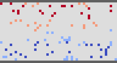
*ρ(wgpu) − ρ(reference), range ±1.19e-7 (lattice units)*

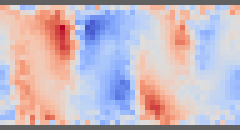
*θ(wgpu) − θ(reference), range ±3.58e-7 (lattice units)*

![|u(wgpu) − u(reference)|, range [0, 3.76e-8] (lattice units)](rayleigh-benard-wgpu-u-diff.png)
*|u(wgpu) − u(reference)|, range [0, 3.76e-8] (lattice units)*

### Diagnostics after the last step

| Quantity | cpu | cuda | wgpu |
|----------|---|---|---|
| mass Σρ (lattice) | 1.151999998e3 | 1.151999998e3 | 1.151999997e3 |
| kinetic energy (lattice) | 1.743693241e-1 | 1.743693231e-1 | 1.743693817e-1 |
| max \|u\| (m/s) | 4.218656893e-1 | 4.218656570e-1 | 4.218658432e-1 |
| thermal energy Σθ (lattice) | -4.214480973e-1 | -4.214500189e-1 | -4.214433432e-1 |

### Forces after the last step (N/m)

| Element | Backend | Fx | Fy |
|---------|---------|----|----|
| Hot plate | cpu | -1.359254e-5 | 3.552663e-3 |
| Hot plate | cuda | -1.359254e-5 | 3.552663e-3 |
| Hot plate | wgpu | -1.361248e-5 | 3.553142e-3 |
| Cold plate | cpu | 1.621054e-5 | -4.720823e-3 |
| Cold plate | cuda | 1.621054e-5 | -4.720823e-3 |
| Cold plate | wgpu | 1.622266e-5 | -4.719319e-3 |

### Force statistics from t = 16.67 s (information)

Coefficients C = 2F/(ρ₀U²L) and St = fL/U with L = 1.000 m, U = 1.000 m/s.

| Element | Backend | Fx mean | Fx min | Fx max | Fy mean | Fy min | Fy max | C_x mean | C_x max | C_y max | f (Hz) | St |
|---------|---------|---------|--------|--------|---------|--------|--------|----------|---------|---------|--------|----|
| Hot plate | cpu | -2.90407e-5 | -1.99879e-4 | 7.54946e-6 | 3.12940e-3 | -9.29820e-3 | 1.24691e-2 | -5.808e-5 | 1.510e-5 | 0.02494 | 3.61252 | 3.61252 |
| Hot plate | cuda | -2.90407e-5 | -1.99879e-4 | 7.54946e-6 | 3.12940e-3 | -9.29820e-3 | 1.24691e-2 | -5.808e-5 | 1.510e-5 | 0.02494 | 3.61252 | 3.61252 |
| Hot plate | wgpu | -2.90482e-5 | -1.99880e-4 | 7.54368e-6 | 3.12904e-3 | -9.29835e-3 | 1.24688e-2 | -5.810e-5 | 1.509e-5 | 0.02494 | 3.61251 | 3.61251 |
| Cold plate | cpu | 3.36910e-5 | -2.42591e-6 | 2.03163e-4 | -5.63781e-3 | -1.75296e-2 | 3.63170e-3 | 6.738e-5 | 4.063e-4 | 0.007263 | 3.61285 | 3.61285 |
| Cold plate | cuda | 3.36910e-5 | -2.42591e-6 | 2.03163e-4 | -5.63781e-3 | -1.75296e-2 | 3.63170e-3 | 6.738e-5 | 4.063e-4 | 0.007263 | 3.61285 | 3.61285 |
| Cold plate | wgpu | 3.36924e-5 | -2.41781e-6 | 2.03164e-4 | -5.63731e-3 | -1.75293e-2 | 3.63182e-3 | 6.738e-5 | 4.063e-4 | 0.007264 | 3.61285 | 3.61285 |

### Reference fields and time series

![Reference speed (m/s), range [5.1134e-3, 4.2187e-1]](rayleigh-benard-reference-speed.png)
*Reference speed (m/s), range [5.1134e-3, 4.2187e-1]*

![Reference temperature (K), range [3.0002e2, 3.0098e2]](rayleigh-benard-reference-temperature.png)
*Reference temperature (K), range [3.0002e2, 3.0098e2]*

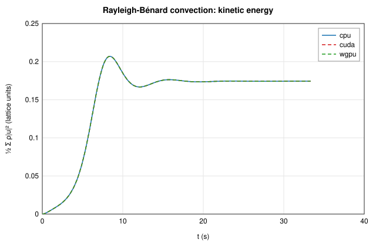

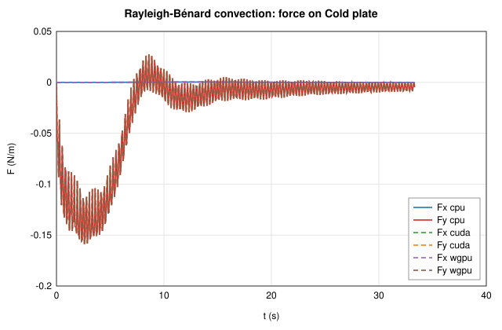

## Notes

- **Fields mode:** pass when the 04 §7 metric of every lattice field is within the tolerance — ρ in absolute terms, ux and uy relative to the largest velocity component of the reference, θ relative to its maximum — and, in a closed domain, the mass (conserved by construction) agrees to 1e-7. The kinetic energy, max |u|, thermal energy, the mass of an open domain and the forces follow from the fields with their own sensitivities (the energy is quadratic in u; forces on pressure-loaded walls measure ρ − 1 relatively), so their differences are shown for information; the parity tests hold the reduction and force kernels to their own limits. *Bit-identical* means every value has the same bits; CUDA (compiled without fused multiply-adds) is expected to be bit-identical to the CPU, wgpu to differ by round-off (its driver contracts multiply-adds).
- **Statistics mode:** in chaotic or unsteady-periodic flows (e.g. the von Kármán street behind the Re = 100 cylinder) round-off differences grow until the instantaneous fields are unrelated, while the statistics are unchanged. The verdict then uses the time series instead, over the statistics window: the oscillation frequency (relative), the mean, minimum and maximum of each force component (relative to the largest force) and the mean kinetic energy (relative). The mass of a closed domain must still agree to 1e-7. The field tables are shown for information.
- **MLUPS** here is the throughput while comparing, with a synchronisation at every sample of the time series; [`cfd-cli bench`](../../docs/benchmarks.md) gives the clean numbers.
